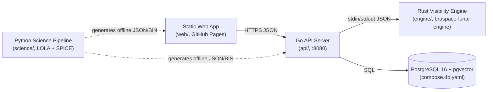

# BRASPACE — Lunar Landing Site Navigator (MoonProof)

**NASA Space Apps Challenge 2026** | [Portuguese version (`README.pt-BR.md`)](README.pt-BR.md)

BRASPACE / MoonProof is an educational and engineering prototype for evaluating lunar south pole landing sites, Sun/Earth visibility windows, terrain horizon masking, and crew/consumables mission planning.

---

## Live Demo & API

Verified on **2026-11-14** (`HTTP 200`):

- **Web App (GitHub Pages):** https://braspace.github.io/
  - Polar Lab: https://braspace.github.io/lab.html
  - Onboard Mission Computer: https://braspace.github.io/onboard/cockpit.html
  - Polar Elevation Map Demo: https://braspace.github.io/polar-map-demo.html
- **Public API:** https://braspace-api.srv1898743.hstgr.cloud
  - Health: https://braspace-api.srv1898743.hstgr.cloud/api/health
  - Readiness: https://braspace-api.srv1898743.hstgr.cloud/readyz
  - Capabilities: https://braspace-api.srv1898743.hstgr.cloud/v1/capabilities
  - Site Catalog: https://braspace-api.srv1898743.hstgr.cloud/api/sites

> **Scientific honesty:** `/readyz` reports `"science_status": "UNVERIFIED_INPUTS"` and `/v1/capabilities` reports `"scientifically_validated": false`.

---

## Real Data vs. Simulation

| NASA / External Source | Product in Repo | Status | Notes |
|---|---|---|---|
| **NASA LOLA (`LDEM_80S_80M`) + NAIF SPICE** | `api/sitedata/series/{connecting-ridge,malapert-massif,mons-mouton-im2,nobile-rim-1,peak-near-shackleton}.json` & `web/data/sites/*`, `web/data/terrain/*` | **PRELIMINARY** (not flight-validated) | Offline pipeline (`science/`) computes terrain horizon and Sun/Earth angles. |
| **Synthetic demo series** | `api/sitedata/series/synthetic-demo-{a,b}.json` | **SYNTHETIC** | Labelled synthetic time series for end-to-end testing and UI demos. |
| **Onboard consumables / battery** | `api/onboard/` & `web/onboard/` | **SIMULATION** | Educational mission computer model; not flight-certified. |
| **NASA PGDA & JPL Horizons** | `web/data/validation/validation_{pgda,horizons}.json` | **BENCHMARK** | Reference comparison datasets for offline science checks. |
| **NASA LROC / SVS** | `web/data/moon/lroc_color_2k.jpg` & layer proxy | **VISUAL ASSET** | See [`docs/ASSET_LICENSE_MATRIX.md`](docs/ASSET_LICENSE_MATRIX.md). |

---

## Architecture



---

## MoonProof screens (`web/moonproof/`)

Design by @lisanogueira (Heloísa), implemented on the shared core (`core/`: tokens, shell, terrain, layers, i18n, state). Every number comes from `web/data/` or the API; the design sheet's illustrative numbers are never in the code (`core-no-design-numbers.test.mjs`).

| Page | Screen | Designer spec |
|---|---|---|
| `mission.html` / `explore.html` | A Mission Control, B Explore (+ mobile, 390 px) | `designer/A-*`, `B-*`, `M1-mobile-explorar` |
| `compare.html` | C Compare (+ mobile) | `designer/C-*`, `M2-mobile-comparar` |
| `recover.html` | D Replan | `designer/D-*` |
| `cockpit.html` | E Cockpit | `designer/E-*` |
| `landing.html` | F Landing Lab | `designer/F-*` |
| `debrief.html` | G Debrief | `designer/G-*` |
| `evidence.html` | H Evidence | `designer/H-*` |
| `present.html`, `activity.html`, `plan.html` | v3 Class kit (present, build activity) and Planning kit | `designer/K1-*`, `K2-*`, `K3-*` |
| `rules.html` | v3 core, layers and kits rules | `designer/V3-camadas` |

Serve with `cd web && node dev-server.mjs` (set `BRASPACE_WEB_PORT` if 5173 is taken) and open `/moonproof/`.

---

## Running Locally

### Quick Start (API + Rust Engine)

```bash
cp .env.example .env
docker compose up -d --build
curl -fsS http://127.0.0.1:8080/api/health
```

- **Default port:** `127.0.0.1:${BRASPACE_PORT:-8080}:8080`
- **With PostgreSQL:** `docker compose -f compose.yaml -f compose.db.yaml up -d --build`
- **With optional pgvector metadata search:** `docker compose -f compose.yaml -f compose.db.yaml -f compose.vector.yaml up -d --build`
- **Environment variables (by name):** `BRASPACE_PORT`, `CORS_ALLOWED_ORIGINS`, `POSTGRES_PASSWORD` (see [`.env.example`](.env.example) and [`docs/DEPLOY.md`](docs/DEPLOY.md)).

---

## Testing

All suites below were run natively on branch `integration/studio-full-20261114` (HEAD `67542db`, 2026-11-14). The Docker `--target test` run is not part of this evidence.

| Suite | Command | Result |
|---|---|---|
| **Web + MoonProof + Onboard (Node test runner)** | `cd web && node --test tests/*.test.mjs moonproof/tests/*.test.mjs onboard/test/*.mjs` | 264 passed, 0 failed, 1 skipped |
| **Web lint** | `npm --prefix web run lint` | exit 0 |
| **Go API** | `cd api && go vet ./... && go test -race -count=1 ./...` | `api` & `api/onboard` pass |
| **Rust Engine** | `cd engine && cargo test --locked --all-targets` | 3 unit + 6 integration passed |
| **Python Science** | `python3 -m unittest discover -s science/tests` | 21 tests OK |
| **Python Root** | `python3 -m unittest discover -s tests` | 9 tests OK |
| **Full stack (web -> Go -> Rust)** | `node scripts/fullstack-e2e.mjs` (with `BRASPACE_E2E_API_BIN`, `BRASPACE_E2E_RUST_BIN`) | PASS (synthetic data only) |

See [`docs/TESTING.md`](docs/TESTING.md) for details.

---

## Repository Structure

| Path | Purpose |
|---|---|
| `api/` | Go HTTP API server (`braspace.mission.v1`), OpenAPI spec (`api/openapi.json`), site catalog & series (`api/sitedata/`). |
| `engine/` | Rust deterministic visibility engine (`braspace-lunar-engine`). |
| `web/` | Static frontend, Polar Lab (`lab.html`), Onboard Cockpit (`onboard/cockpit.html`), polar map demo (`polar-map-demo.html`), and precomputed data (`web/data/`). |
| `science/` | Python offline pipeline for NASA LOLA DEMs, NAIF SPICE kernels, and PGDA/Horizons benchmarks. |
| `docs/` | Architecture, API reference, data provenance, testing, deploy, and team documentation ([`docs/README.md`](docs/README.md)). |
| `scripts/` | Audit, smoke-test (`smoke-publico.sh`), and verification scripts. |
| `tests/` | Repository-level Python unit tests. |
| `compose*.yaml` | Docker Compose definitions for API, PostgreSQL, and optional pgvector. |

---

## Team & Roles

From [`docs/TEAM_ROLES_AND_HANDOFFS_2026.md`](docs/TEAM_ROLES_AND_HANDOFFS_2026.md):

- **Gustavo** — Integration, Infrastructure & Release
- **Gabriel Maccachero** — Data & NASA Sources
- **Gabriel Freire** — Backend API & Database
- **Joel** — Rust Engine & Scientific Calculations
- **Heloísa** — UX/UI & Frontend
- **João Victor** — QA & Onboard Mission Computer

---

## License & NASA Credits

- Code: [MIT License](LICENSE) (`Copyright (c) 2026 Braspace`).
- NASA & external assets: see [`docs/ASSET_LICENSE_MATRIX.md`](docs/ASSET_LICENSE_MATRIX.md) and [`docs/ATTRIBUTION_AND_LICENSES.md`](docs/ATTRIBUTION_AND_LICENSES.md).

---

## Honest Limitations

- **Not flight-certified:** `/readyz` reports `UNVERIFIED_INPUTS` and `/v1/capabilities` reports `scientifically_validated: false`.
- **Partial series coverage:** `/api/health` reports `16` catalog sites, of which `7` have stored time series (`5` `PRELIMINARY`, `2` `SYNTHETIC`); the remaining `9` sites have no stored visibility series yet.
- **Offline science pipeline:** LOLA + SPICE computations run offline in `science/` and are loaded as static JSON/BIN artifacts rather than computed dynamically per HTTP request.
