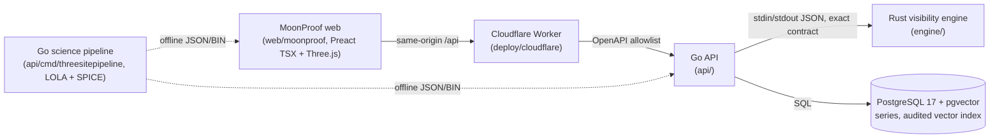

# BRASPACE — Lunar Landing Site Navigator (MoonProof)

**NASA Space Apps Challenge 2026** | [Portuguese version (`README.pt-BR.md`)](README.pt-BR.md)

BRASPACE / MoonProof is an educational and engineering prototype for evaluating lunar south pole landing sites, Sun/Earth visibility windows, terrain horizon masking, and crew/consumables mission planning.

---

## Live Demo & API

Verified in production on **2026-11-15** (main `dc2411b`, Worker `c792c009`, published with `deploy/cloudflare/deploy.sh`; API image `ad83cfe7517c`):

- **MoonProof, the product:** https://braspace-moonproof.almeida-me.workers.dev/moonproof/. A Cloudflare Worker serves `web/` and proxies every OpenAPI route same-origin to the Go API. Polar Lab, Onboard, Studio, Classic and the old shell are archived in `archive/web-legacy/`.
- **Public API:** https://braspace-api.srv1898743.hstgr.cloud: [`/api/health`](https://braspace-api.srv1898743.hstgr.cloud/api/health), [`/readyz`](https://braspace-api.srv1898743.hstgr.cloud/readyz), [`/v1/capabilities`](https://braspace-api.srv1898743.hstgr.cloud/v1/capabilities), [`/api/sites`](https://braspace-api.srv1898743.hstgr.cloud/api/sites), [`/api/vector/status`](https://braspace-api.srv1898743.hstgr.cloud/api/vector/status).
- **Additional live API check (2026-11-15):** `GET /api/health` returned `sites=16`, `sites_with_series=16`, `PRELIMINARY=14`, `SYNTHETIC=2`, `engine=ready`, `data_source=postgres`. All nine newly added real site detail endpoints responded HTTP 200 with 64-hex-character `series_sha256`, hourly `step_seconds=3600` and `science_status=PRELIMINARY`. This is endpoint/metadata verification, **not** binary checksum recomputation, full browser QA or scientific validation. The public `/moonproof/` still served the old persona chooser at this check; cockpit-first routing is in draft PR #403.
- **Last production QA (#351, #374):** 13 screens × 320/390/768/1024/1440/1920 = 78 runs. All HTTP 200, 0 overflow, 0 clipped controls, 0 console errors, 0 HTTP errors, 246 API calls all 200. Backend probes 7/7: pgvector `index_ready`, search serves only audited sources, 720 h onboard window, strict JSON.

- **Production QA, main `dc2411b` (EXO-X1, Chrome):** route matrix `web/browser/route-matrix.mjs` (16 pages × 320–1920 px) 96/96 with a real GPU and 95/96 without WebGL (1 local network change); axe-core WCAG 2/2.1 A+AA **0 violations** on the 13 screens × 2 viewports (#398); Lighthouse with warm edge: Index 97, Cockpit 89, Mission 85–88 (LCP 3.4 s).
- **Performance:** three.js 0.181.0 vendored in `web/vendor/three` (no CDN, one THREE instance, #365); NASA-derived binary grids gzip-encoded by the Worker, −48% on the wire (#406, #417); the 2D hillshade is not painted while the Moon HD relief is loading (#420).
- **CI:** GitHub-hosted runners are blocked by Actions billing; `ci.yml` and the browser workflow run on self-hosted runners `exo-x1` selected by the repository variable `CI_RUNS_ON` (#383, #388). Delete the variable to return to `ubuntu-latest`.
- **Docs & operations:**
  - release [`v2026.11.15-prod-2b62474`](https://github.com/Braspace/Braspace/releases/tag/v2026.11.15-prod-2b62474);
  - API reference [`docs/API.md`](docs/API.md), 22 operations, generated from `api/openapi.json` and checked in CI;
  - cockpit ↔ backend contract [`docs/COCKPIT_BACKEND_CONTRACT.md`](docs/COCKPIT_BACKEND_CONTRACT.md), 49/49 in production;
  - deploys, backups and rollback [`docs/harness/STATUS.md`](docs/harness/STATUS.md);
  - lane owners [`docs/harness/OWNERS.md`](docs/harness/OWNERS.md);
  - series grid rule [`docs/harness/GRID_SEMANTICS_EVIDENCE.md`](docs/harness/GRID_SEMANTICS_EVIDENCE.md): a start or duration off the hourly grid gets `GRID_NOT_ALIGNED` (compare: per site) and is never rounded. Measured in production.

> **Scientific honesty:** `/readyz` reports `"science_status": "UNVERIFIED_INPUTS"` and `/v1/capabilities` reports `"scientifically_validated": false`. Series are `PRELIMINARY_NOT_INDEPENDENTLY_VALIDATED`.

## Real Data vs. Simulation

| NASA / External Source | Product in Repo | Status | Notes |
|---|---|---|---|
| **NASA LOLA (`LDEM_80S_80M`) + NAIF SPICE** | `api/sitedata/series/*.json` (14 source-derived real sites), `web/data/sites/*`, `web/data/terrain/*` | **PRELIMINARY** (not flight-validated) | Offline pipeline (`science/`) computes terrain horizon and Sun/Earth angles; source inputs SHA-pinned, independently unvalidated. Two additional demonstration sites are `SYNTHETIC`. |
| **Synthetic demo series** | `api/sitedata/series/synthetic-demo-{a,b}.json` | **SYNTHETIC** | Labelled synthetic time series for end-to-end testing and UI demos. |
| **Onboard battery / crew consumables** | `api/onboard/`, `api/consumables.go` & the MoonProof cockpit (`web/moonproof/screens/cockpit*`) | **SIMULATION** | Educational mission computer model; not flight-certified. O2/food rates are placeholders pending a check against NASA BVAD. |
| **NASA PGDA & JPL Horizons** | `web/data/validation/validation_{pgda,horizons}.json` | **BENCHMARK** | Reference comparison datasets for offline science checks. |
| **NASA LROC / SVS** | `web/data/moon/lroc_color_2k.jpg` & layer proxy | **VISUAL ASSET** | See [`docs/ASSET_LICENSE_MATRIX.md`](docs/ASSET_LICENSE_MATRIX.md). |

---

## Architecture



- **pgvector:** the provenance metadata index (`braspace-lexical-384-v1`) is a lexical projection, not a trained embedding. `/api/vector/status` reports `index_ready` with the audited and quarantined (`legacy_unverified`) counts, and search serves only the current audited manifest. It is never used as lunar physics.
- **Science pipeline:** Go port of the former Python tools (`api/cmd/*`). The NASA/NAIF/PGDA inputs are SHA-256 pinned (`docs/DATA_PROVENANCE.md`); `TestReproducesCommittedSummary/Study` regenerates the committed results byte for byte when the inputs are provided.

## MoonProof screens (`web/moonproof/`)

Design by @lisanogueira (Heloísa), implemented on the shared core (`core/`: tokens, shell, terrain, layers, i18n, state). Every number comes from `web/data/` or the API; the design sheet's illustrative numbers are never in the code (`core-no-design-numbers.test.mjs`).

| Page | Screen | Designer spec |
|---|---|---|
| `mission.html` / `explore.html` | A Mission Control, B Explore (+ mobile, 390 px) | `designer/A-*`, `B-*`, `M1-mobile-explorar` |
| `compare.html` | C Compare (+ mobile) | `designer/C-*`, `M2-mobile-comparar` |
| `recover.html` | D Replan | `designer/D-*` |
| `cockpit.html` | E Cockpit | `designer/E-*` |
| `landing.html` | F Landing Lab | `designer/F-*` |
| `debrief.html` | G Debrief | `designer/G-*` |
| `evidence.html` | H Evidence | `designer/H-*` |
| `present.html`, `activity.html`, `plan.html` | v3 Class kit (present, build activity) and Planning kit | `designer/K1-*`, `K2-*`, `K3-*` |
| `rules.html` | v3 core, layers and kits rules | `designer/V3-camadas` |

Serve with `cd web && node dev-server.mjs` (set `BRASPACE_WEB_PORT` if 5173 is taken) and open `/moonproof/`.

### One Moon, every screen (runtime)

- **Explore the Moon ↔ Show panels** on every screen: Joel's Moon HD (`web/moon-hd/backdrop.ts`) behind the panels or full screen, with the catalogue sites from `GET /api/sites` as pins; the camera orbits the selected site in perspective. Map screens keep their LOLA relief and load the 3D only on demand.
- **Cockpit:** an illustrative Artemis-style lander (`web/moon-hd/artemis.ts`) over the south pole on that same scene — the same model as the gamified Landing Lab. Not telemetry.
- **Density** (`web/moonproof/core/density.css`) and collapsible panels within Heloísa's design system; ≥ 44 px touch targets; Lighthouse A11y/SEO 100.
- Details, public `window.moonBackdrop` API and the Worker deploy runbook: [`docs/MOONPROOF_FRONT_RUNTIME.md`](docs/MOONPROOF_FRONT_RUNTIME.md).

---

## Running Locally

### Quick Start (API + Rust Engine)

```bash
cp .env.example .env
docker compose up -d --build
curl -fsS http://127.0.0.1:8080/api/health
```

- **Default port:** `127.0.0.1:${BRASPACE_PORT:-8080}:8080`
- **With PostgreSQL:** `docker compose -f compose.yaml -f compose.db.yaml up -d --build`
- **With optional pgvector metadata search:** `docker compose -f compose.yaml -f compose.db.yaml -f compose.vector.yaml up -d --build`
- **Environment variables (by name):** `BRASPACE_PORT`, `CORS_ALLOWED_ORIGINS`, `POSTGRES_PASSWORD` (see [`.env.example`](.env.example) and [`docs/DEPLOY.md`](docs/DEPLOY.md)).

---

## Testing

One command runs the same matrix as CI on any machine with Docker: `bash scripts/ci-local.sh --browser`. It covers the Worker contract, `docker build --target test` (Go vet/gofmt/race, Rust, web lint/tests/TS check, science), the release image, Compose with PostgreSQL, endpoints, the cockpit ↔ Go/Rust/Postgres contract, the public smoke, Go tests against Postgres, and Chromium desktop/mobile.

GitHub Actions run on the self-hosted runner `exo-x1` (`vars.CI_RUNS_ON`, #383) while hosted minutes are blocked by org billing.

| Evidence (2026-11-15) | SHA | Result |
|---|---|---|
| `scripts/ci-local.sh --browser` (#363 backend contracts) | `bad55c1` | 12/12 PASS |
| `scripts/ci-local.sh --browser` (#369 solar-disc fix) | `036bed3` | 12/12 PASS |
| GitHub Actions `ci` on self-hosted (#383) | `05c30dd` | success |
| Production QA, 78 runs + backend probes 7/7 | `9dab20c` + `2b62474` | 0 findings |

## Repository Structure

| Path | Purpose |
|---|---|
| `api/` | Go HTTP API server (`braspace.mission.v1`), OpenAPI spec (`api/openapi.json`), site catalog & series (`api/sitedata/`). |
| `engine/` | Rust deterministic visibility engine (`braspace-lunar-engine`). |
| `web/` | MoonProof (`web/moonproof/`, Preact TSX), the Three.js Moon HD viewer (`moon-hd.html`), shared Lab modules and precomputed data (`web/data/`). Legacy surfaces: `archive/web-legacy/`. |
| `science/` | Python offline pipeline for NASA LOLA DEMs, NAIF SPICE kernels, and PGDA/Horizons benchmarks. |
| `docs/` | Architecture, API reference, data provenance, testing, deploy, and team documentation ([`docs/README.md`](docs/README.md)). |
| `scripts/` | Audit, smoke-test (`smoke-publico.sh`), and verification scripts. |
| `tests/` | Repository-level Python unit tests. |
| `compose*.yaml` | Docker Compose definitions for API, PostgreSQL, and optional pgvector. |

---

## Team & Roles

From [`docs/TEAM_ROLES_AND_HANDOFFS_2026.md`](docs/TEAM_ROLES_AND_HANDOFFS_2026.md):

- **Gustavo** — Integration, Infrastructure & Release
- **Gabriel Maccachero** — Data & NASA Sources
- **Gabriel Freire** — Backend API & Database
- **Joel** — Rust Engine & Scientific Calculations
- **Heloísa** — UX/UI & Frontend
- **João Victor** — QA & Onboard Mission Computer

---

## License & NASA Credits

- Code: [MIT License](LICENSE) (`Copyright (c) 2026 Braspace`).
- NASA & external assets: see [`docs/ASSET_LICENSE_MATRIX.md`](docs/ASSET_LICENSE_MATRIX.md) and [`docs/ATTRIBUTION_AND_LICENSES.md`](docs/ATTRIBUTION_AND_LICENSES.md).

---

## Honest Limitations

- **Not flight-certified:** `/readyz` reports `UNVERIFIED_INPUTS` and `/v1/capabilities` reports `scientifically_validated: false`.
- **Series coverage:** all 14 real catalog sites have a stored LOLA + SPICE series (`PRELIMINARY`), plus 2 `SYNTHETIC` demo sites. Three high-illumination ridges near Shackleton (Peak near Shackleton, de Gerlache Rim 1, de Gerlache-Kocher Massif) exceed NASA PGDA by more than 5 pp and are shown as an upper bound.
- **Solar-disc fraction:** corrected on 2026-11-15 (#369). The Go port had inherited an inverted formula, so the derived values were regenerated from SHA-verified NASA inputs (Peak near Shackleton is still the only site more than 5 pp above NASA PGDA, now 8.54 pp). Sun and Earth are otherwise treated as points against the LOLA horizon.
- **pgvector:** metadata retrieval only. 10 legacy rows without an ingest manifest are quarantined (`legacy_unverified`) and are not served.
- **Deploys:** backend deploys use `deploy/harness/swap-api.sh` (#389), a start-first swap that routes only to the healthy new replica: 1 failed request in about 570, down from 43 failures in 5.4 s with a plain `compose up`.

