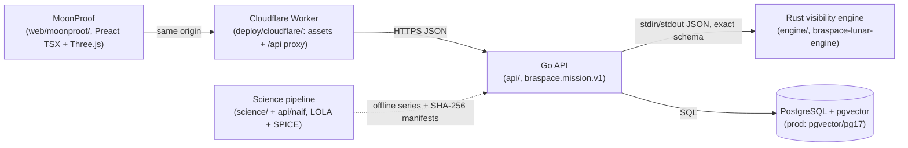

# BRASPACE — Lunar Landing Site Navigator (MoonProof)

**NASA Space Apps Challenge 2026** | [Portuguese version (`README.pt-BR.md`)](README.pt-BR.md)

BRASPACE / MoonProof is an educational and engineering prototype for evaluating lunar south pole landing sites, Sun/Earth visibility windows, terrain horizon masking, and crew/consumables mission planning.

---

## Live Product & API

Checked on **2026-11-15** in production (edge of the Cloudflare Worker):

- **MoonProof, the product:** https://braspace-moonproof.almeida-me.workers.dev/moonproof/
  - It is the only product surface. Classic, Polar Lab, Onboard, Studio, Dashboard and the old shell are archived in `archive/web-legacy/` (#321). `/` redirects to `/moonproof/`.
  - The same Worker proxies `/api/*`, `/v1/*`, `/healthz` and `/readyz` to the Go API on the same origin (`deploy/cloudflare/`, allowlist = `api/openapi.json`). There is no CORS in the browser.
- **Public API (direct):** https://braspace-api.srv1898743.hstgr.cloud
  - `/api/health`, `/readyz`, `/v1/capabilities`, `/api/sites`, `/api/vector/status`; full contract in [`api/openapi.json`](api/openapi.json).
- **Production backend:** release [`v2026.11.15-prod-2b62474`](https://github.com/Braspace/Braspace/releases/tag/v2026.11.15-prod-2b62474). `/healthz` reports the exact `build_commit`.
- **Live status, release runbook and who owns what:** [`docs/harness/STATUS.md`](docs/harness/STATUS.md), [`docs/harness/HANDOFF.md`](docs/harness/HANDOFF.md), [`docs/harness/OWNERS.md`](docs/harness/OWNERS.md).
- GitHub Pages (`braspace.github.io`) is no longer the product entry; it returned 404 on 2026-11-15.

> **Scientific honesty:** `/readyz` reports `"science_status": "UNVERIFIED_INPUTS"` and `/v1/capabilities` reports `"scientifically_validated": false`.

---

## Real Data vs. Simulation

| NASA / External Source | Product in Repo | Status | Notes |
|---|---|---|---|
| **NASA LOLA (`LDEM_80S_80M`) + NAIF SPICE** | `api/sitedata/series/{connecting-ridge,malapert-massif,mons-mouton-im2,nobile-rim-1,peak-near-shackleton}.json` & `web/data/sites/*`, `web/data/terrain/*` | **PRELIMINARY** (not flight-validated) | Offline pipeline (`science/`) computes terrain horizon and Sun/Earth angles. |
| **Synthetic demo series** | `api/sitedata/series/synthetic-demo-{a,b}.json` | **SYNTHETIC** | Labelled synthetic time series for end-to-end testing and UI demos. |
| **Onboard battery / crew consumables** | `api/onboard/`, `api/consumables.go` & the MoonProof Cockpit (`web/moonproof/cockpit.html`) | **SIMULATION** | Educational mission computer model; not flight-certified. O2/food rates are placeholders pending a check against NASA BVAD. |
| **NASA PGDA & JPL Horizons** | `web/data/validation/validation_{pgda,horizons}.json` | **BENCHMARK** | Reference comparison datasets for offline science checks. |
| **NASA LROC / SVS** | `web/data/moon/lroc_color_2k.jpg` & layer proxy | **VISUAL ASSET** | See [`docs/ASSET_LICENSE_MATRIX.md`](docs/ASSET_LICENSE_MATRIX.md). |

---

## Architecture



- **pgvector** only retrieves provenance metadata. It never computes physics. `/api/vector/status` reports the index state: `disabled`, `schema_unavailable`, `empty`, `index_ready`, `model_mismatch`, `legacy_unverified` or `db_down`. Search serves only rows from the current audited ingest manifest; older rows without a manifest are kept but quarantined.
- **Series grid:** a start or duration off the series grid (hourly) is rejected with `GRID_NOT_ALIGNED` and never rounded ([`docs/harness/GRID_SEMANTICS_EVIDENCE.md`](docs/harness/GRID_SEMANTICS_EVIDENCE.md)).

---

## MoonProof screens (`web/moonproof/`)

Design by @lisanogueira (Heloísa), implemented on the shared core (`core/`: tokens, shell, terrain, layers, i18n, state). Every number comes from `web/data/` or the API; the design sheet's illustrative numbers are never in the code (`core-no-design-numbers.test.mjs`).

| Page | Screen | Designer spec |
|---|---|---|
| `mission.html` / `explore.html` | A Mission Control, B Explore (+ mobile, 390 px) | `designer/A-*`, `B-*`, `M1-mobile-explorar` |
| `compare.html` | C Compare (+ mobile) | `designer/C-*`, `M2-mobile-comparar` |
| `recover.html` | D Replan | `designer/D-*` |
| `cockpit.html` | E Cockpit | `designer/E-*` |
| `landing.html` | F Landing Lab | `designer/F-*` |
| `debrief.html` | G Debrief | `designer/G-*` |
| `evidence.html` | H Evidence | `designer/H-*` |
| `present.html`, `activity.html`, `plan.html` | v3 Class kit (present, build activity) and Planning kit | `designer/K1-*`, `K2-*`, `K3-*` |
| `rules.html` | v3 core, layers and kits rules | `designer/V3-camadas` |

Serve with `cd web && node dev-server.mjs` (set `BRASPACE_WEB_PORT` if 5173 is taken) and open `/moonproof/`.

---

## Running Locally

### Quick Start (API + Rust Engine)

```bash
cp .env.example .env
docker compose up -d --build
curl -fsS http://127.0.0.1:8080/api/health
```

- **Default port:** `127.0.0.1:${BRASPACE_PORT:-8080}:8080`
- **With PostgreSQL:** `docker compose -f compose.yaml -f compose.db.yaml up -d --build`
- **With optional pgvector metadata search:** `docker compose -f compose.yaml -f compose.db.yaml -f compose.vector.yaml up -d --build`
- **Environment variables (by name):** `BRASPACE_PORT`, `CORS_ALLOWED_ORIGINS`, `POSTGRES_PASSWORD` (see [`.env.example`](.env.example) and [`docs/DEPLOY.md`](docs/DEPLOY.md)).

---

## Testing

GitHub Actions does not run at the moment (an organization billing block). The release gate is the same script that the workflow calls, run on the team machine:

```bash
scripts/ci-local.sh --browser
```

It runs these steps:

- Worker proxy contract
- `docker build --target test`: Go vet + race, Rust `cargo test --locked`, web lint/tests, science
- Release image
- Compose (API + PostgreSQL + ingest), endpoints and replay
- Cockpit ↔ Go/Rust/PostgreSQL contract (`scripts/cockpit-backend-contract.mjs`)
- Public smoke
- Go tests against PostgreSQL and against **real pgvector**
- Chromium e2e

Last results (2026-11-15):

| Gate | Where | Result |
|---|---|---|
| `scripts/ci-local.sh --browser` | backend release candidate `4e2853a` (#374) | **GREEN 12/12** |
| `scripts/cockpit-backend-contract.mjs` with `BRASPACE_EXPECT_COMMIT` | production, through the Worker (`2b62474`) | **49/49 PASS** |

More in [`docs/TESTING.md`](docs/TESTING.md).

---|---|---|
| **Web + MoonProof + Onboard (Node test runner)** | `cd web && node --test tests/*.test.mjs moonproof/tests/*.test.mjs onboard/test/*.mjs` | 264 passed, 0 failed, 1 skipped |
| **Web lint** | `npm --prefix web run lint` | exit 0 |
| **Go API** | `cd api && go vet ./... && go test -race -count=1 ./...` | `api` & `api/onboard` pass |
| **Rust Engine** | `cd engine && cargo test --locked --all-targets` | 3 unit + 6 integration passed |
| **Python Science** | `python3 -m unittest discover -s science/tests` | 21 tests OK |
| **Python Root** | `python3 -m unittest discover -s tests` | 9 tests OK |
| **Full stack (web -> Go -> Rust)** | `node scripts/fullstack-e2e.mjs` (with `BRASPACE_E2E_API_BIN`, `BRASPACE_E2E_RUST_BIN`) | PASS (synthetic data only) |

See [`docs/TESTING.md`](docs/TESTING.md) for details.

---

## Repository Structure

| Path | Purpose |
|---|---|
| `api/` | Go HTTP API server (`braspace.mission.v1`), OpenAPI spec (`api/openapi.json`), site catalog & series (`api/sitedata/`). |
| `engine/` | Rust deterministic visibility engine (`braspace-lunar-engine`). |
| `web/` | MoonProof (`web/moonproof/`, Preact TSX), the Three.js Moon HD viewer (`moon-hd.html`), shared Lab modules and precomputed data (`web/data/`). Legacy surfaces: `archive/web-legacy/`. |
| `science/` | Python offline pipeline for NASA LOLA DEMs, NAIF SPICE kernels, and PGDA/Horizons benchmarks. |
| `docs/` | Architecture, API reference, data provenance, testing, deploy, and team documentation ([`docs/README.md`](docs/README.md)). |
| `scripts/` | Audit, smoke-test (`smoke-publico.sh`), and verification scripts. |
| `tests/` | Repository-level Python unit tests. |
| `compose*.yaml` | Docker Compose definitions for API, PostgreSQL, and optional pgvector. |

---

## Team & Roles

From [`docs/TEAM_ROLES_AND_HANDOFFS_2026.md`](docs/TEAM_ROLES_AND_HANDOFFS_2026.md):

- **Gustavo** — Integration, Infrastructure & Release
- **Gabriel Maccachero** — Data & NASA Sources
- **Gabriel Freire** — Backend API & Database
- **Joel** — Rust Engine & Scientific Calculations
- **Heloísa** — UX/UI & Frontend
- **João Victor** — QA & Onboard Mission Computer

---

## License & NASA Credits

- Code: [MIT License](LICENSE) (`Copyright (c) 2026 Braspace`).
- NASA & external assets: see [`docs/ASSET_LICENSE_MATRIX.md`](docs/ASSET_LICENSE_MATRIX.md) and [`docs/ATTRIBUTION_AND_LICENSES.md`](docs/ATTRIBUTION_AND_LICENSES.md).

---

## Honest Limitations

- **Not flight-certified:** `/readyz` reports `UNVERIFIED_INPUTS` and `/v1/capabilities` reports `scientifically_validated: false`.
- **Partial series coverage:** `/api/health` reports `16` catalog sites, of which `7` have stored time series (`5` `PRELIMINARY`, `2` `SYNTHETIC`); the remaining `9` sites have no stored visibility series yet.
- **Offline science pipeline:** LOLA + SPICE computations run offline in `science/` and are loaded as static JSON/BIN artifacts rather than computed dynamically per HTTP request.
