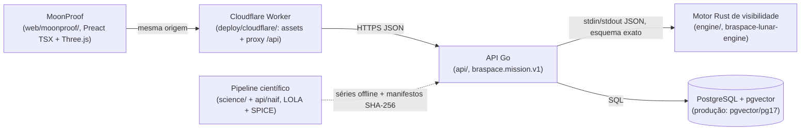

# BRASPACE — Navegador de Sítios de Pouso Lunar (MoonProof)

**NASA Space Apps Challenge 2026** | [Versão em inglês (`README.md`)](README.md)

O BRASPACE / MoonProof é um protótipo educacional e de engenharia para avaliar sítios de pouso no polo sul lunar, janelas de visibilidade Sol/Terra, bloqueio de horizonte pelo terreno e planejamento de missão (consumíveis e tripulação).

---

## Produto e API em produção

Conferido em **2026-11-15** em produção (pela borda do Cloudflare Worker):

- **MoonProof, o produto:** https://braspace-moonproof.almeida-me.workers.dev/moonproof/
  - É a única superfície do produto. Classic, Polar Lab, Onboard, Studio, Dashboard e o shell antigo estão arquivados em `archive/web-legacy/` (#321). `/` redireciona para `/moonproof/`.
  - O mesmo Worker repassa `/api/*`, `/v1/*`, `/healthz` e `/readyz` para a API Go na mesma origem (`deploy/cloudflare/`, allowlist = `api/openapi.json`). Não há CORS no navegador.
- **API pública (direta):** https://braspace-api.srv1898743.hstgr.cloud
  - `/api/health`, `/readyz`, `/v1/capabilities`, `/api/sites`, `/api/vector/status`; contrato completo em [`api/openapi.json`](api/openapi.json).
- **Backend em produção:** release [`v2026.11.15-prod-2b62474`](https://github.com/Braspace/Braspace/releases/tag/v2026.11.15-prod-2b62474). O `/healthz` informa o `build_commit` exato.
- **Status ao vivo, runbook de release e quem cuida de quê:** [`docs/harness/STATUS.md`](docs/harness/STATUS.md), [`docs/harness/HANDOFF.md`](docs/harness/HANDOFF.md), [`docs/harness/OWNERS.md`](docs/harness/OWNERS.md).
- O GitHub Pages (`braspace.github.io`) deixou de ser a entrada do produto; respondeu 404 em 2026-11-15.

> **Honestidade científica:** `/readyz` informa `"science_status": "UNVERIFIED_INPUTS"` e `/v1/capabilities` informa `"scientifically_validated": false`.

---

## Dado Real vs. Simulação

| Fonte NASA / Externa | Produto no Repositório | Estado | Observações |
|---|---|---|---|
| **NASA LOLA (`LDEM_80S_80M`) + NAIF SPICE** | `api/sitedata/series/{connecting-ridge,malapert-massif,mons-mouton-im2,nobile-rim-1,peak-near-shackleton}.json` e `web/data/sites/*`, `web/data/terrain/*` | **PRELIMINARY** (não validado para voo) | Pipeline offline (`science/`) calcula horizonte do terreno e ângulos Sol/Terra. |
| **Séries sintéticas de demonstração** | `api/sitedata/series/synthetic-demo-{a,b}.json` | **SYNTHETIC** | Séries rotuladas como sintéticas para testes ponta a ponta e demonstração. |
| **Bateria de bordo / consumíveis da tripulação** | `api/onboard/`, `api/consumables.go` e o Cockpit do MoonProof (`web/moonproof/cockpit.html`) | **SIMULAÇÃO** | Modelo educacional do computador de bordo; não certificado para voo. Taxas de O2/comida são provisórias, a conferir com o NASA BVAD. |
| **NASA PGDA e JPL Horizons** | `web/data/validation/validation_{pgda,horizons}.json` | **BENCHMARK** | Conjuntos de referência para checagens científicas offline. |
| **NASA LROC / SVS** | `web/data/moon/lroc_color_2k.jpg` e proxy de camadas | **ATIVO VISUAL** | Ver [`docs/ASSET_LICENSE_MATRIX.md`](docs/ASSET_LICENSE_MATRIX.md). |

---

## Arquitetura



- **pgvector** só recupera metadados de proveniência. Nunca calcula física. O `/api/vector/status` informa o estado do índice: `disabled`, `schema_unavailable`, `empty`, `index_ready`, `model_mismatch`, `legacy_unverified` ou `db_down`. A busca só serve linhas do manifesto de ingestão auditado atual; as linhas antigas sem manifesto são preservadas, mas ficam em quarentena.
- **Grade da série:** início ou duração fora da grade da série (horária) é recusado com `GRID_NOT_ALIGNED` e nunca arredondado ([`docs/harness/GRID_SEMANTICS_EVIDENCE.md`](docs/harness/GRID_SEMANTICS_EVIDENCE.md)).

---

## Telas MoonProof (`web/moonproof/`)

Design de @lisanogueira (Heloísa), implementado sobre o core comum (`core/`: tokens, shell, terreno, camadas, i18n, estado). Todo número vem de `web/data/` ou da API; os números ilustrativos do desenho nunca entram no código (`core-no-design-numbers.test.mjs`).

| Página | Tela | Spec do designer |
|---|---|---|
| `mission.html` / `explore.html` | A Mission Control, B Explore (+ celular, 390 px) | `designer/A-*`, `B-*`, `M1-mobile-explorar` |
| `compare.html` | C Compare (+ celular) | `designer/C-*`, `M2-mobile-comparar` |
| `recover.html` | D Replan | `designer/D-*` |
| `cockpit.html` | E Cockpit | `designer/E-*` |
| `landing.html` | F Landing Lab | `designer/F-*` |
| `debrief.html` | G Debrief | `designer/G-*` |
| `evidence.html` | H Evidence | `designer/H-*` |
| `present.html`, `activity.html`, `plan.html` | v3 Kit Aula (apresentar, montar atividade) e Kit Planejamento | `designer/K1-*`, `K2-*`, `K3-*` |
| `rules.html` | v3 regras de núcleo, camadas e kits | `designer/V3-camadas` |

Sirva com `cd web && node dev-server.mjs` (defina `BRASPACE_WEB_PORT` se a 5173 estiver ocupada) e abra `/moonproof/`.

---

## Como Rodar Localmente

### Início Rápido (API + Motor Rust)

```bash
cp .env.example .env
docker compose up -d --build
curl -fsS http://127.0.0.1:8080/api/health
```

- **Porta padrão:** `127.0.0.1:${BRASPACE_PORT:-8080}:8080`
- **Com PostgreSQL:** `docker compose -f compose.yaml -f compose.db.yaml up -d --build`
- **Com busca vetorial opcional (pgvector):** `docker compose -f compose.yaml -f compose.db.yaml -f compose.vector.yaml up -d --build`
- **Variáveis de ambiente (por nome):** `BRASPACE_PORT`, `CORS_ALLOWED_ORIGINS`, `POSTGRES_PASSWORD` (ver [`.env.example`](.env.example) e [`docs/DEPLOY.md`](docs/DEPLOY.md)).

---

## Testes

O GitHub Actions não está rodando no momento (bloqueio de cobrança da organização). O portão de release é o mesmo script que o workflow chama, rodado na máquina da equipe:

```bash
scripts/ci-local.sh --browser
```

Ele roda estas etapas:

- Contrato do proxy do Worker
- `docker build --target test`: Go vet + race, Rust `cargo test --locked`, lint/testes web, ciência
- Imagem de release
- Compose (API + PostgreSQL + ingestão), endpoints e replay
- Contrato Cockpit ↔ Go/Rust/PostgreSQL (`scripts/cockpit-backend-contract.mjs`)
- Smoke público
- Testes Go contra PostgreSQL e contra **pgvector real**
- e2e no Chromium

Últimos resultados (2026-11-15):

| Portão | Onde | Resultado |
|---|---|---|
| `scripts/ci-local.sh --browser` | candidato de release do backend `4e2853a` (#374) | **GREEN 12/12** |
| `scripts/cockpit-backend-contract.mjs` com `BRASPACE_EXPECT_COMMIT` | produção, pelo Worker (`2b62474`) | **49/49 PASS** |

Mais detalhes em [`docs/TESTING.md`](docs/TESTING.md).

---|---|---|
| **Web + MoonProof + Computador de Bordo (Node test runner)** | `cd web && node --test tests/*.test.mjs moonproof/tests/*.test.mjs onboard/test/*.mjs` | 264 passaram, 0 falharam, 1 pulado |
| **Lint web** | `npm --prefix web run lint` | exit 0 |
| **API Go** | `cd api && go vet ./... && go test -race -count=1 ./...` | `api` e `api/onboard` passam |
| **Motor Rust** | `cd engine && cargo test --locked --all-targets` | 3 unitários + 6 integração passaram |
| **Ciência Python** | `python3 -m unittest discover -s science/tests` | 21 testes OK |
| **Raiz Python** | `python3 -m unittest discover -s tests` | 9 testes OK |
| **Full stack (web -> Go -> Rust)** | `node scripts/fullstack-e2e.mjs` (com `BRASPACE_E2E_API_BIN`, `BRASPACE_E2E_RUST_BIN`) | PASS (só dados sintéticos) |

Veja [`docs/TESTING.md`](docs/TESTING.md) para detalhes.

---

## Mapa de Pastas

| Pasta | Finalidade |
|---|---|
| `api/` | Servidor HTTP Go (`braspace.mission.v1`), especificação OpenAPI (`api/openapi.json`), catálogo e séries (`api/sitedata/`). |
| `engine/` | Motor determinístico em Rust (`braspace-lunar-engine`). |
| `web/` | MoonProof (`web/moonproof/`, Preact TSX), visualizador 3D Moon HD em Three.js (`moon-hd.html`), módulos compartilhados do Lab e dados pré-computados (`web/data/`). Superfícies antigas: `archive/web-legacy/`. |
| `science/` | Pipeline offline em Python para DEMs LOLA da NASA, kernels NAIF SPICE e benchmarks PGDA/Horizons. |
| `docs/` | Documentação de arquitetura, API, proveniência de dados, testes, deploy e time ([`docs/README.md`](docs/README.md)). |
| `scripts/` | Scripts de auditoria, smoke-test (`smoke-publico.sh`) e verificação. |
| `tests/` | Testes unitários Python na raiz do repositório. |
| `compose*.yaml` | Definições Docker Compose para API, PostgreSQL e pgvector opcional. |

---

## Time e Papéis

Conforme [`docs/TEAM_ROLES_AND_HANDOFFS_2026.md`](docs/TEAM_ROLES_AND_HANDOFFS_2026.md):

- **Gustavo** — Integração, Infraestrutura e Release
- **Gabriel Maccachero** — Dados e Fontes NASA
- **Gabriel Freire** — API Backend e Banco de Dados
- **Joel** — Motor Rust e Cálculos Científicos
- **Heloísa** — UX/UI e Frontend
- **João Victor** — QA e Computador de Bordo

---

## Licença e Créditos NASA

- Código: [Licença MIT](LICENSE) (`Copyright (c) 2026 Braspace`).
- Ativos NASA e externos: ver [`docs/ASSET_LICENSE_MATRIX.md`](docs/ASSET_LICENSE_MATRIX.md) e [`docs/ATTRIBUTION_AND_LICENSES.md`](docs/ATTRIBUTION_AND_LICENSES.md).

---

## Limitações Honestas

- **Não certificado para voo:** `/readyz` retorna `UNVERIFIED_INPUTS` e `/v1/capabilities` retorna `scientifically_validated: false`.
- **Cobertura parcial de séries:** `/api/health` retorna `16` sítios no catálogo, dos quais `7` possuem séries temporais armazenadas (`5` `PRELIMINARY`, `2` `SYNTHETIC`); os `9` sítios restantes ainda não possuem séries de visibilidade.
- **Pipeline científico offline:** Os cálculos LOLA + SPICE rodam offline em `science/` e são carregados como artefatos JSON/BIN estáticos, não calculados dinamicamente por requisição HTTP.
