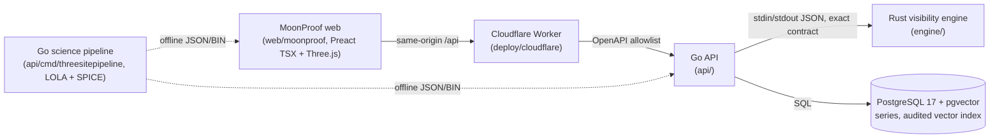

# BRASPACE — Navegador de Sítios de Pouso Lunar (MoonProof)

**NASA Space Apps Challenge 2026** | [Versão em inglês (`README.md`)](README.md)

O BRASPACE / MoonProof é um protótipo educacional e de engenharia para avaliar sítios de pouso no polo sul lunar, janelas de visibilidade Sol/Terra, bloqueio de horizonte pelo terreno e planejamento de missão (consumíveis e tripulação).

---

## Cockpit único — entrada principal canônica (15/11/2026, candidato)

A decisão atual é **um único Cockpit** como experiência principal em `/moonproof/`, utilizando o adaptador same-origin `screens/cockpit-entry.js` para entrar em `cockpit.html`. O redirecionamento preserva todos os parâmetros e fragmentos de URL com `location.replace` e deixa um link visível para abrir o Cockpit quando não houver JavaScript, sem script inline (CSP). A Lua 3D do Polo Sul de Joel, a Artemis ilustrativa e os nove painéis independentes continuam no Cockpit; a Lua 3D sempre visível atrás dos painéis é o requisito do issue #456.

O seletor **Explorar / Aula / Planejar** foi mantido em `/moonproof/tasks.html`, junto com os módulos Preact, links, arquivos e ferramentas de cada integrante. O primeiro acesso ao Cockpit oferece tutorial acessível (PRs #451/#452) e os tours auxiliares continuam disponíveis. Esta reconciliação corrige a divergência da página inicial de três modos trazida pelo #455, conforme a decisão documentada no issue #457, com testes das rotas e dos links de contexto.

**Gate de publicação:** candidato de código, não deploy confirmado. Exigir SHA exato, testes CI/Chromium GPU e sem GPU no EXO-X1, integração Go/Rust/Postgres/pgvector, responsividade Heloísa e verificação Worker/rollback.

## Demo no Ar e API

Verificado em produção em **2026-11-15** (main `dc2411b`, Worker `c792c009`, publicado com `deploy/cloudflare/deploy.sh`; imagem da API `ad83cfe7517c`):

- **MoonProof, o produto:** https://braspace-moonproof.almeida-me.workers.dev/moonproof/. Um Cloudflare Worker serve `web/` e repassa cada rota da OpenAPI à API Go na mesma origem. Polar Lab, Onboard, Studio, Classic e o shell antigo estão arquivados em `archive/web-legacy/`.
- **API pública:** https://braspace-api.srv1898743.hstgr.cloud: [`/api/health`](https://braspace-api.srv1898743.hstgr.cloud/api/health), [`/readyz`](https://braspace-api.srv1898743.hstgr.cloud/readyz), [`/v1/capabilities`](https://braspace-api.srv1898743.hstgr.cloud/v1/capabilities), [`/api/sites`](https://braspace-api.srv1898743.hstgr.cloud/api/sites), [`/api/vector/status`](https://braspace-api.srv1898743.hstgr.cloud/api/vector/status).
- **Verificação adicional da API pública (15/11/2026):** `GET /api/health` retornou `sites=16`, `sites_with_series=16`, `PRELIMINARY=14`, `SYNTHETIC=2`, `engine=ready`, `data_source=postgres`. Os endpoints de detalhe dos nove novos locais reais responderam HTTP 200 com `series_sha256` de 64 dígitos hexadecimais, grade horária `step_seconds=3600` e `science_status=PRELIMINARY`. Essa checagem de endpoints/metadados **não** equivale a recalcular checksums dos binários, QA completo no navegador ou validação científica. `/moonproof/` ainda mostrava o seletor de perfis nessa consulta; a entrada direta está no PR draft #403.
- **Último QA de produção (#351, #374):** 13 telas × 320/390/768/1024/1440/1920 = 78 execuções. Todas com HTTP 200, 0 overflow, 0 controles cortados, 0 erros de console, 0 erros HTTP, 246 chamadas de API todas 200. Sondas do backend 7/7: pgvector `index_ready`, busca serve só fontes auditadas, janela de 720 h, JSON estrito.

- **QA de produção, main `dc2411b` (EXO-X1, Chrome):** matriz de rotas `web/browser/route-matrix.mjs` (16 páginas × 320–1920 px) 96/96 com GPU real e 95/96 sem WebGL (1 troca de rede local); axe-core WCAG 2/2.1 A+AA **0 violações** nas 13 telas × 2 viewports (#398); Lighthouse com borda aquecida: Index 97, Cockpit 89, Mission 85–88 (LCP 3,4 s).
- **Desempenho:** three.js 0.181.0 vendorizado em `web/vendor/three` (sem CDN, uma instância de THREE, #365); grids binários derivados da NASA comprimidos com gzip pelo Worker, −48% na rede (#406, #417); o relevo 2D não é desenhado enquanto o relevo Moon HD carrega (#420).
- **CI:** os runners hospedados do GitHub estão bloqueados pela cobrança do Actions; o `ci.yml` e o workflow de navegador rodam nos runners self-hosted `exo-x1`, escolhidos pela variável de repositório `CI_RUNS_ON` (#383, #388). Apagar a variável volta ao `ubuntu-latest`.
- **Documentação e operação:**
  - release [`v2026.11.15-prod-2b62474`](https://github.com/Braspace/Braspace/releases/tag/v2026.11.15-prod-2b62474);
  - referência da API [`docs/API.md`](docs/API.md), 22 operações, gerada do `api/openapi.json` e conferida no CI;
  - contrato cockpit ↔ backend [`docs/COCKPIT_BACKEND_CONTRACT.md`](docs/COCKPIT_BACKEND_CONTRACT.md), 49/49 em produção;
  - deploys, backups e rollback [`docs/harness/STATUS.md`](docs/harness/STATUS.md);
  - donos de cada frente [`docs/harness/OWNERS.md`](docs/harness/OWNERS.md);
  - regra da grade da série [`docs/harness/GRID_SEMANTICS_EVIDENCE.md`](docs/harness/GRID_SEMANTICS_EVIDENCE.md): início ou duração fora da grade horária recebe `GRID_NOT_ALIGNED` (no compare, por local) e nunca é arredondado. Medido em produção.

> **Honestidade científica:** `/readyz` retorna `"science_status": "UNVERIFIED_INPUTS"` e `/v1/capabilities` retorna `"scientifically_validated": false`. As séries são `PRELIMINARY_NOT_INDEPENDENTLY_VALIDATED`.
> **Candidato Cockpit P0 (#411, não publicado):** Os nove grupos Preact podem ser ocultados independentemente sem duplicar a Lua Three.js de Joel nem o módulo Artemis ilustrativo. A ação assíncrona `Só a Lua` agora verifica se os painéis ainda estão ocultos antes de abrir a cena 3D; restaurá-los antes do carregamento cancela o pedido obsoleto. Fixture Node: 3/3 PASS; JS gerado conferido contra a saída local TypeScript 5.8.3. O gate real com TypeScript 5.6.3, Chromium, Go/Rust e pgvector permanece obrigatório. Entrada canônica em #440, densidade 75% em #426 e verificação do SHA Worker em #424.


## Verificação da versão do Worker (PR draft #424 — não publicado)

Os scripts de smoke exigem uma declaração **executável e idêntica** a `const BRASPACE_COMMIT = "<SHA de 40 hex>";` no `/config.js` servido, em vez de uma substring que possa aparecer em comentários ou em versões diferentes. O uso de `grep -Fxq` corresponde à linha exata gerada por `deploy/cloudflare/deploy.sh`. O teste `deploy/cloudflare/build-stamp.test.mjs` cobre declaração válida, comentários enganosos, sufixos e SHA incorreto. Fixture isolada Node 22: 3/3 PASS. A correção **não** passou ainda pelo gate completo CI/EXO-X1 e não houve merge/deploy. As séries científicas, Go/Rust e PostgreSQL/pgvector não foram modificados.

## Dado Real vs. Simulação

| Fonte NASA / Externa | Produto no Repositório | Estado | Observações |
|---|---|---|---|
| **NASA LOLA (`LDEM_80S_80M`) + NAIF SPICE** | `api/sitedata/series/*.json` (14 locais reais derivados de fontes), `web/data/sites/*`, `web/data/terrain/*` | **PRELIMINARY** (não validado para voo) | Pipeline offline (`science/`) calcula horizonte e ângulos Sol/Terra; fontes com SHA fixado, ainda sem validação científica independente. Mais dois locais de demonstração são `SYNTHETIC`. |
| **Séries sintéticas de demonstração** | `api/sitedata/series/synthetic-demo-{a,b}.json` | **SYNTHETIC** | Séries rotuladas como sintéticas para testes ponta a ponta e demonstração. |
| **Bateria de bordo / consumíveis da tripulação** | `api/onboard/`, `api/consumables.go` e o cockpit do MoonProof (`web/moonproof/screens/cockpit*`) | **SIMULAÇÃO** | Modelo educacional do computador de bordo; não certificado para voo. Taxas de O2/comida são provisórias, a conferir com o NASA BVAD. |
| **NASA PGDA e JPL Horizons** | `web/data/validation/validation_{pgda,horizons}.json` | **BENCHMARK** | Conjuntos de referência para checagens científicas offline. |
| **NASA LROC / SVS** | `web/data/moon/lroc_color_2k.jpg` e proxy de camadas | **ATIVO VISUAL** | Ver [`docs/ASSET_LICENSE_MATRIX.md`](docs/ASSET_LICENSE_MATRIX.md). |

---

## Arquitetura



- **pgvector:** o índice de metadados de proveniência (`braspace-lexical-384-v1`) é uma projeção léxica, não um embedding treinado. `/api/vector/status` informa `index_ready` com as contagens de auditadas e de isoladas (`legacy_unverified`), e a busca serve só o manifesto auditado atual. Nunca é usado como física lunar.
- **Pipeline científico:** port em Go das antigas ferramentas Python (`api/cmd/*`). As entradas NASA/NAIF/PGDA têm SHA-256 fixado (`docs/DATA_PROVENANCE.md`); `TestReproducesCommittedSummary/Study` regenera os resultados versionados byte a byte quando as entradas são fornecidas.

## Telas MoonProof (`web/moonproof/`)

Design de @lisanogueira (Heloísa), implementado sobre o core comum (`core/`: tokens, shell, terreno, camadas, i18n, estado). Todo número vem de `web/data/` ou da API; os números ilustrativos do desenho nunca entram no código (`core-no-design-numbers.test.mjs`).

| Página | Tela | Spec do designer |
|---|---|---|
| `mission.html` / `explore.html` | A Mission Control, B Explore (+ celular, 390 px) | `designer/A-*`, `B-*`, `M1-mobile-explorar` |
| `compare.html` | C Compare (+ celular) | `designer/C-*`, `M2-mobile-comparar` |
| `recover.html` | D Replan | `designer/D-*` |
| `cockpit.html` | E Cockpit | `designer/E-*` |
| `landing.html` | F Landing Lab | `designer/F-*` |
| `debrief.html` | G Debrief | `designer/G-*` |
| `evidence.html` | H Evidence | `designer/H-*` |
| `present.html`, `activity.html`, `plan.html` | v3 Kit Aula (apresentar, montar atividade) e Kit Planejamento | `designer/K1-*`, `K2-*`, `K3-*` |
| `rules.html` | v3 regras de núcleo, camadas e kits | `designer/V3-camadas` |

Sirva com `cd web && node dev-server.mjs` (defina `BRASPACE_WEB_PORT` se a 5173 estiver ocupada) e abra `/moonproof/`.

### Uma Lua, todas as telas (runtime)

- **Explorar a Lua ↔ Mostrar painéis** em todas as telas: o Moon HD do Joel (`web/moon-hd/backdrop.ts`) atrás dos painéis ou em tela cheia, com os locais do catálogo (`GET /api/sites`) como pins; a câmera orbita o local escolhido em perspectiva. Telas de mapa mantêm o relevo LOLA e só carregam o 3D quando pedido.
- **Cockpit:** lander ilustrativo estilo Artemis (`web/moon-hd/artemis.ts`) sobre o polo sul na mesma cena — o mesmo modelo do Landing Lab gamificado. Não é telemetria.
- **Nove controles de painéis P0 (candidato, ainda não publicado):** `web/moonproof/screens/cockpit-panels.tsx` permite recolher individualmente bateria, Sol/Terra, horas de Sol, regras, alertas, falhas, tripulação, linha do tempo e relatório, com **Só a Lua** / **Restaurar painéis**. Preserva os tokens da Heloísa e abre a Lua 3D pelo controle lazy já existente, sem segundo renderizador; o indicador de bateria atual usa um contêiner Preact `mp-node`. Antes de publicar, exigir Chromium GPU/sem GPU, seis resoluções e CI fullstack no EXO-X1.
- **Densidade** (`web/moonproof/core/density.css`) e painéis recolhíveis dentro do design system da Heloísa; alvos de toque ≥ 44 px; Lighthouse A11y/SEO 100.
- Detalhes, API pública `window.moonBackdrop` e roteiro de deploy do Worker: [`docs/MOONPROOF_FRONT_RUNTIME.md`](docs/MOONPROOF_FRONT_RUNTIME.md).

---

## Como Rodar Localmente

### Início Rápido (API + Motor Rust)

```bash
cp .env.example .env
docker compose up -d --build
curl -fsS http://127.0.0.1:8080/api/health
```

- **Porta padrão:** `127.0.0.1:${BRASPACE_PORT:-8080}:8080`
- **Com PostgreSQL:** `docker compose -f compose.yaml -f compose.db.yaml up -d --build`
- **Com busca vetorial opcional (pgvector):** `docker compose -f compose.yaml -f compose.db.yaml -f compose.vector.yaml up -d --build`
- **Variáveis de ambiente (por nome):** `BRASPACE_PORT`, `CORS_ALLOWED_ORIGINS`, `POSTGRES_PASSWORD` (ver [`.env.example`](.env.example) e [`docs/DEPLOY.md`](docs/DEPLOY.md)).

---

## Como Testar

Um comando roda a mesma matriz do CI em qualquer máquina com Docker: `bash scripts/ci-local.sh --browser`. Ele cobre o contrato do Worker, `docker build --target test` (Go vet/gofmt/race, Rust, lint/testes/TS da web, ciência), a imagem de release, o Compose com PostgreSQL, os endpoints, o contrato cockpit ↔ Go/Rust/Postgres, o smoke público, os testes Go contra o Postgres e o Chromium desktop/mobile.

O GitHub Actions roda no runner self-hosted `exo-x1` (`vars.CI_RUNS_ON`, #383) enquanto os minutos hospedados estão bloqueados pela cobrança da organização.

| Evidência (2026-11-15) | SHA | Resultado |
|---|---|---|
| `scripts/ci-local.sh --browser` (#363, contratos do backend) | `bad55c1` | 12/12 PASS |
| `scripts/ci-local.sh --browser` (#369, correção do disco solar) | `036bed3` | 12/12 PASS |
| GitHub Actions `ci` no self-hosted (#383) | `05c30dd` | success |
| QA de produção, 78 execuções + sondas do backend 7/7 | `9dab20c` + `2b62474` | 0 achados |

## Mapa de Pastas

| Pasta | Finalidade |
|---|---|
| `api/` | Servidor HTTP Go (`braspace.mission.v1`), especificação OpenAPI (`api/openapi.json`), catálogo e séries (`api/sitedata/`). |
| `engine/` | Motor determinístico em Rust (`braspace-lunar-engine`). |
| `web/` | MoonProof (`web/moonproof/`, Preact TSX), visualizador 3D Moon HD em Three.js (`moon-hd.html`), módulos compartilhados do Lab e dados pré-computados (`web/data/`). Superfícies antigas: `archive/web-legacy/`. |
| `science/` | Pipeline offline em Python para DEMs LOLA da NASA, kernels NAIF SPICE e benchmarks PGDA/Horizons. |
| `docs/` | Documentação de arquitetura, API, proveniência de dados, testes, deploy e time ([`docs/README.md`](docs/README.md)). |
| `scripts/` | Scripts de auditoria, smoke-test (`smoke-publico.sh`) e verificação. |
| `tests/` | Testes unitários Python na raiz do repositório. |
| `compose*.yaml` | Definições Docker Compose para API, PostgreSQL e pgvector opcional. |

---

## Time e Papéis

Conforme [`docs/TEAM_ROLES_AND_HANDOFFS_2026.md`](docs/TEAM_ROLES_AND_HANDOFFS_2026.md):

- **Gustavo** — Integração, Infraestrutura e Release
- **Gabriel Maccachero** — Dados e Fontes NASA
- **Gabriel Freire** — API Backend e Banco de Dados
- **Joel** — Motor Rust e Cálculos Científicos
- **Heloísa** — UX/UI e Frontend
- **João Victor** — QA e Computador de Bordo

---

## Licença e Créditos NASA

- Código: [Licença MIT](LICENSE) (`Copyright (c) 2026 Braspace`).
- Ativos NASA e externos: ver [`docs/ASSET_LICENSE_MATRIX.md`](docs/ASSET_LICENSE_MATRIX.md) e [`docs/ATTRIBUTION_AND_LICENSES.md`](docs/ATTRIBUTION_AND_LICENSES.md).

---

## Limitações Honestas

- **Sem certificação de voo:** `/readyz` retorna `UNVERIFIED_INPUTS` e `/v1/capabilities` retorna `scientifically_validated: false`.
- **Cobertura de séries:** todos os 14 sítios reais do catálogo têm série LOLA + SPICE armazenada (`PRELIMINARY`), mais 2 sítios de demonstração `SYNTHETIC`. Três cristas muito iluminadas perto de Shackleton (Peak near Shackleton, de Gerlache Rim 1, de Gerlache-Kocher Massif) ficam mais de 5 pp acima do NASA PGDA e recebem aviso de limitação preliminar do modelo. O desvio frente ao PGDA, sozinho, não prova um limite superior físico.
- **Fração do disco solar:** corrigida em 2026-11-15 (#369). O port em Go tinha herdado uma fórmula invertida, então os valores derivados foram regenerados a partir de entradas NASA com SHA verificado (o catálogo de 14 locais atualmente tem três regiões acima do PGDA em mais de 5 pontos percentuais: Peak near Shackleton +8,53 pp, de Gerlache Rim 1 +7,95 pp e de Gerlache–Kocher Massif +7,64 pp; são discrepâncias frente ao benchmark, não validação científica). No mais, Sol e Terra são tratados como pontos contra o horizonte LOLA.
- **pgvector:** só recuperação de metadados. 10 linhas antigas sem manifesto de ingestão ficam isoladas (`legacy_unverified`) e não são servidas.
- **Deploys:** os deploys do backend usam `deploy/harness/swap-api.sh` (#389), uma troca *start-first* que só roteia para a réplica nova saudável: 1 requisição com falha em cerca de 570, contra 43 falhas em 5,4 s com um `compose up` simples.

