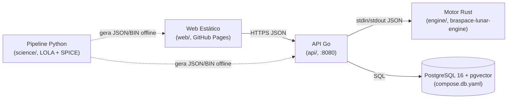

# BRASPACE — Navegador de Sítios de Pouso Lunar (MoonProof)

**NASA Space Apps Challenge 2026** | [Versão em inglês (`README.md`)](README.md)

O BRASPACE / MoonProof é um protótipo educacional e de engenharia para avaliar sítios de pouso no polo sul lunar, janelas de visibilidade Sol/Terra, bloqueio de horizonte pelo terreno e planejamento de missão (consumíveis e tripulação).

---

## Demo no Ar e API

Conferido em **2026-11-14** (`HTTP 200`):

- **Aplicação Web (GitHub Pages):** https://braspace.github.io/
  - Polar Lab: https://braspace.github.io/lab.html
  - Computador de Bordo (Onboard Cockpit): https://braspace.github.io/onboard/cockpit.html
  - Demo do Mapa Polar: https://braspace.github.io/polar-map-demo.html
- **API Pública:** https://braspace-api.srv1898743.hstgr.cloud
  - Saúde: https://braspace-api.srv1898743.hstgr.cloud/api/health
  - Prontidão: https://braspace-api.srv1898743.hstgr.cloud/readyz
  - Capacidades: https://braspace-api.srv1898743.hstgr.cloud/v1/capabilities
  - Catálogo de Sítios: https://braspace-api.srv1898743.hstgr.cloud/api/sites

> **Honestidade científica:** `/readyz` retorna `"science_status": "UNVERIFIED_INPUTS"` e `/v1/capabilities` retorna `"scientifically_validated": false`.

---

## Dado Real vs. Simulação

| Fonte NASA / Externa | Produto no Repositório | Estado | Observações |
|---|---|---|---|
| **NASA LOLA (`LDEM_80S_80M`) + NAIF SPICE** | `api/sitedata/series/{connecting-ridge,malapert-massif,mons-mouton-im2,nobile-rim-1,peak-near-shackleton}.json` e `web/data/sites/*`, `web/data/terrain/*` | **PRELIMINARY** (não validado para voo) | Pipeline offline (`science/`) calcula horizonte do terreno e ângulos Sol/Terra. |
| **Séries sintéticas de demonstração** | `api/sitedata/series/synthetic-demo-{a,b}.json` | **SYNTHETIC** | Séries rotuladas como sintéticas para testes ponta a ponta e demonstração. |
| **Consumíveis / bateria de bordo** | `api/onboard/` e `web/onboard/` | **SIMULAÇÃO** | Modelo educacional do computador de bordo; não certificado para voo. |
| **NASA PGDA e JPL Horizons** | `web/data/validation/validation_{pgda,horizons}.json` | **BENCHMARK** | Conjuntos de referência para checagens científicas offline. |
| **NASA LROC / SVS** | `web/data/moon/lroc_color_2k.jpg` e proxy de camadas | **ATIVO VISUAL** | Ver [`docs/ASSET_LICENSE_MATRIX.md`](docs/ASSET_LICENSE_MATRIX.md). |

---

## Arquitetura



---

## Como Rodar Localmente

### Início Rápido (API + Motor Rust)

```bash
cp .env.example .env
docker compose up -d --build
curl -fsS http://127.0.0.1:8080/api/health
```

- **Porta padrão:** `127.0.0.1:${BRASPACE_PORT:-8080}:8080`
- **Com PostgreSQL:** `docker compose -f compose.yaml -f compose.db.yaml up -d --build`
- **Com busca vetorial opcional (pgvector):** `docker compose -f compose.yaml -f compose.db.yaml -f compose.vector.yaml up -d --build`
- **Variáveis de ambiente (por nome):** `BRASPACE_PORT`, `CORS_ALLOWED_ORIGINS`, `POSTGRES_PASSWORD` (ver [`.env.example`](.env.example) e [`docs/DEPLOY.md`](docs/DEPLOY.md)).

---

## Como Testar

Todas as suítes conferidas na `main` (`0e646c3c50ad665c34013415809e951e489a3b0f`):

| Suíte | Comando | Resultado |
|---|---|---|
| **Web (Node test runner)** | `npm --prefix web test` | 74 passaram, 0 falharam |
| **Computador de Bordo** | `node --test web/onboard/test/*.mjs` | 49 passaram, 0 falharam, 1 pulado |
| **API Go** | `cd api && go test ./...` | `api` e `api/onboard` passam |
| **Motor Rust** | `cd engine && cargo test` | 3 unitários + 6 integração passaram |
| **Ciência Python** | `python3 -m unittest discover -s science/tests` | 21 testes OK |
| **Raiz Python** | `python3 -m unittest discover -s tests` | 9 testes OK |

Veja [`docs/TESTING.md`](docs/TESTING.md) para detalhes.

---

## Mapa de Pastas

| Pasta | Finalidade |
|---|---|
| `api/` | Servidor HTTP Go (`braspace.mission.v1`), especificação OpenAPI (`api/openapi.json`), catálogo e séries (`api/sitedata/`). |
| `engine/` | Motor determinístico em Rust (`braspace-lunar-engine`). |
| `web/` | Frontend estático, Polar Lab (`lab.html`), Computador de Bordo (`onboard/cockpit.html`), demo polar (`polar-map-demo.html`) e dados pré-computados (`web/data/`). |
| `science/` | Pipeline offline em Python para DEMs LOLA da NASA, kernels NAIF SPICE e benchmarks PGDA/Horizons. |
| `docs/` | Documentação de arquitetura, API, proveniência de dados, testes, deploy e time ([`docs/README.md`](docs/README.md)). |
| `scripts/` | Scripts de auditoria, smoke-test (`smoke-publico.sh`) e verificação. |
| `tests/` | Testes unitários Python na raiz do repositório. |
| `compose*.yaml` | Definições Docker Compose para API, PostgreSQL e pgvector opcional. |

---

## Time e Papéis

Conforme [`docs/TEAM_ROLES_AND_HANDOFFS_2026.md`](docs/TEAM_ROLES_AND_HANDOFFS_2026.md):

- **Gustavo** — Integração, Infraestrutura e Release
- **Gabriel Maccachero** — Dados e Fontes NASA
- **Gabriel Freire** — API Backend e Banco de Dados
- **Joel** — Motor Rust e Cálculos Científicos
- **Heloísa** — UX/UI e Frontend
- **João Victor** — QA e Computador de Bordo

---

## Licença e Créditos NASA

- Código: [Licença MIT](LICENSE) (`Copyright (c) 2026 Braspace`).
- Ativos NASA e externos: ver [`docs/ASSET_LICENSE_MATRIX.md`](docs/ASSET_LICENSE_MATRIX.md) e [`docs/ATTRIBUTION_AND_LICENSES.md`](docs/ATTRIBUTION_AND_LICENSES.md).

---

## Limitações Honestas

- **Não certificado para voo:** `/readyz` retorna `UNVERIFIED_INPUTS` e `/v1/capabilities` retorna `scientifically_validated: false`.
- **Cobertura parcial de séries:** `/api/health` retorna `16` sítios no catálogo, dos quais `7` possuem séries temporais armazenadas (`5` `PRELIMINARY`, `2` `SYNTHETIC`); os `9` sítios restantes ainda não possuem séries de visibilidade.
- **Pipeline científico offline:** Os cálculos LOLA + SPICE rodam offline em `science/` e são carregados como artefatos JSON/BIN estáticos, não calculados dinamicamente por requisição HTTP.
