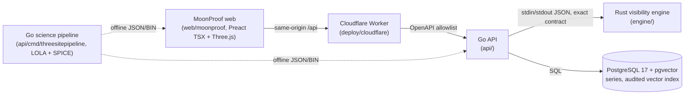

# BRASPACE — Navegador de Sítios de Pouso Lunar (MoonProof)

**NASA Space Apps Challenge 2026** | [Versão em inglês (`README.md`)](README.md)

O BRASPACE / MoonProof é um protótipo educacional e de engenharia para avaliar sítios de pouso no polo sul lunar, janelas de visibilidade Sol/Terra, bloqueio de horizonte pelo terreno e planejamento de missão (consumíveis e tripulação).

---

## Demo no Ar e API

Verificado em produção em **2026-11-15** (frontend `9dab20c`, Worker `ec490d15`; backend `2b62474`):

- **MoonProof, o produto:** https://braspace-moonproof.almeida-me.workers.dev/moonproof/. Um Cloudflare Worker serve `web/` e repassa cada rota da OpenAPI à API Go na mesma origem. Polar Lab, Onboard, Studio, Classic e o shell antigo estão arquivados em `archive/web-legacy/`.
- **API pública:** https://braspace-api.srv1898743.hstgr.cloud: [`/api/health`](https://braspace-api.srv1898743.hstgr.cloud/api/health), [`/readyz`](https://braspace-api.srv1898743.hstgr.cloud/readyz), [`/v1/capabilities`](https://braspace-api.srv1898743.hstgr.cloud/v1/capabilities), [`/api/sites`](https://braspace-api.srv1898743.hstgr.cloud/api/sites), [`/api/vector/status`](https://braspace-api.srv1898743.hstgr.cloud/api/vector/status).
- **Último QA de produção (#351, #374):** 13 telas × 320/390/768/1024/1440/1920 = 78 execuções. Todas com HTTP 200, 0 overflow, 0 controles cortados, 0 erros de console, 0 erros HTTP, 246 chamadas de API todas 200. Sondas do backend 7/7: pgvector `index_ready`, busca serve só fontes auditadas, janela de 720 h, JSON estrito.

> **Honestidade científica:** `/readyz` retorna `"science_status": "UNVERIFIED_INPUTS"` e `/v1/capabilities` retorna `"scientifically_validated": false`. As séries são `PRELIMINARY_NOT_INDEPENDENTLY_VALIDATED`.

## Dado Real vs. Simulação

| Fonte NASA / Externa | Produto no Repositório | Estado | Observações |
|---|---|---|---|
| **NASA LOLA (`LDEM_80S_80M`) + NAIF SPICE** | `api/sitedata/series/{connecting-ridge,malapert-massif,mons-mouton-im2,nobile-rim-1,peak-near-shackleton}.json` e `web/data/sites/*`, `web/data/terrain/*` | **PRELIMINARY** (não validado para voo) | Pipeline offline (`science/`) calcula horizonte do terreno e ângulos Sol/Terra. |
| **Séries sintéticas de demonstração** | `api/sitedata/series/synthetic-demo-{a,b}.json` | **SYNTHETIC** | Séries rotuladas como sintéticas para testes ponta a ponta e demonstração. |
| **Bateria de bordo / consumíveis da tripulação** | `api/onboard/`, `api/consumables.go` e o cockpit do MoonProof (`web/moonproof/screens/cockpit*`) | **SIMULAÇÃO** | Modelo educacional do computador de bordo; não certificado para voo. Taxas de O2/comida são provisórias, a conferir com o NASA BVAD. |
| **NASA PGDA e JPL Horizons** | `web/data/validation/validation_{pgda,horizons}.json` | **BENCHMARK** | Conjuntos de referência para checagens científicas offline. |
| **NASA LROC / SVS** | `web/data/moon/lroc_color_2k.jpg` e proxy de camadas | **ATIVO VISUAL** | Ver [`docs/ASSET_LICENSE_MATRIX.md`](docs/ASSET_LICENSE_MATRIX.md). |

---

## Arquitetura



- **pgvector:** o índice de metadados de proveniência (`braspace-lexical-384-v1`) é uma projeção léxica, não um embedding treinado. `/api/vector/status` informa `index_ready` com as contagens de auditadas e de isoladas (`legacy_unverified`), e a busca serve só o manifesto auditado atual. Nunca é usado como física lunar.
- **Pipeline científico:** port em Go das antigas ferramentas Python (`api/cmd/*`). As entradas NASA/NAIF/PGDA têm SHA-256 fixado (`docs/DATA_PROVENANCE.md`); `TestReproducesCommittedSummary/Study` regenera os resultados versionados byte a byte quando as entradas são fornecidas.

## Telas MoonProof (`web/moonproof/`)

Design de @lisanogueira (Heloísa), implementado sobre o core comum (`core/`: tokens, shell, terreno, camadas, i18n, estado). Todo número vem de `web/data/` ou da API; os números ilustrativos do desenho nunca entram no código (`core-no-design-numbers.test.mjs`).

| Página | Tela | Spec do designer |
|---|---|---|
| `mission.html` / `explore.html` | A Mission Control, B Explore (+ celular, 390 px) | `designer/A-*`, `B-*`, `M1-mobile-explorar` |
| `compare.html` | C Compare (+ celular) | `designer/C-*`, `M2-mobile-comparar` |
| `recover.html` | D Replan | `designer/D-*` |
| `cockpit.html` | E Cockpit | `designer/E-*` |
| `landing.html` | F Landing Lab | `designer/F-*` |
| `debrief.html` | G Debrief | `designer/G-*` |
| `evidence.html` | H Evidence | `designer/H-*` |
| `present.html`, `activity.html`, `plan.html` | v3 Kit Aula (apresentar, montar atividade) e Kit Planejamento | `designer/K1-*`, `K2-*`, `K3-*` |
| `rules.html` | v3 regras de núcleo, camadas e kits | `designer/V3-camadas` |

Sirva com `cd web && node dev-server.mjs` (defina `BRASPACE_WEB_PORT` se a 5173 estiver ocupada) e abra `/moonproof/`.

---

## Como Rodar Localmente

### Início Rápido (API + Motor Rust)

```bash
cp .env.example .env
docker compose up -d --build
curl -fsS http://127.0.0.1:8080/api/health
```

- **Porta padrão:** `127.0.0.1:${BRASPACE_PORT:-8080}:8080`
- **Com PostgreSQL:** `docker compose -f compose.yaml -f compose.db.yaml up -d --build`
- **Com busca vetorial opcional (pgvector):** `docker compose -f compose.yaml -f compose.db.yaml -f compose.vector.yaml up -d --build`
- **Variáveis de ambiente (por nome):** `BRASPACE_PORT`, `CORS_ALLOWED_ORIGINS`, `POSTGRES_PASSWORD` (ver [`.env.example`](.env.example) e [`docs/DEPLOY.md`](docs/DEPLOY.md)).

---

## Como Testar

Um comando roda a mesma matriz do CI em qualquer máquina com Docker: `bash scripts/ci-local.sh --browser`. Ele cobre o contrato do Worker, `docker build --target test` (Go vet/gofmt/race, Rust, lint/testes/TS da web, ciência), a imagem de release, o Compose com PostgreSQL, os endpoints, o contrato cockpit ↔ Go/Rust/Postgres, o smoke público, os testes Go contra o Postgres e o Chromium desktop/mobile.

O GitHub Actions roda no runner self-hosted `exo-x1` (`vars.CI_RUNS_ON`, #383) enquanto os minutos hospedados estão bloqueados pela cobrança da organização.

| Evidência (2026-11-15) | SHA | Resultado |
|---|---|---|
| `scripts/ci-local.sh --browser` (#363, contratos do backend) | `bad55c1` | 12/12 PASS |
| `scripts/ci-local.sh --browser` (#369, correção do disco solar) | `036bed3` | 12/12 PASS |
| GitHub Actions `ci` no self-hosted (#383) | `05c30dd` | success |
| QA de produção, 78 execuções + sondas do backend 7/7 | `9dab20c` + `2b62474` | 0 achados |

## Mapa de Pastas

| Pasta | Finalidade |
|---|---|
| `api/` | Servidor HTTP Go (`braspace.mission.v1`), especificação OpenAPI (`api/openapi.json`), catálogo e séries (`api/sitedata/`). |
| `engine/` | Motor determinístico em Rust (`braspace-lunar-engine`). |
| `web/` | MoonProof (`web/moonproof/`, Preact TSX), visualizador 3D Moon HD em Three.js (`moon-hd.html`), módulos compartilhados do Lab e dados pré-computados (`web/data/`). Superfícies antigas: `archive/web-legacy/`. |
| `science/` | Pipeline offline em Python para DEMs LOLA da NASA, kernels NAIF SPICE e benchmarks PGDA/Horizons. |
| `docs/` | Documentação de arquitetura, API, proveniência de dados, testes, deploy e time ([`docs/README.md`](docs/README.md)). |
| `scripts/` | Scripts de auditoria, smoke-test (`smoke-publico.sh`) e verificação. |
| `tests/` | Testes unitários Python na raiz do repositório. |
| `compose*.yaml` | Definições Docker Compose para API, PostgreSQL e pgvector opcional. |

---

## Time e Papéis

Conforme [`docs/TEAM_ROLES_AND_HANDOFFS_2026.md`](docs/TEAM_ROLES_AND_HANDOFFS_2026.md):

- **Gustavo** — Integração, Infraestrutura e Release
- **Gabriel Maccachero** — Dados e Fontes NASA
- **Gabriel Freire** — API Backend e Banco de Dados
- **Joel** — Motor Rust e Cálculos Científicos
- **Heloísa** — UX/UI e Frontend
- **João Victor** — QA e Computador de Bordo

---

## Licença e Créditos NASA

- Código: [Licença MIT](LICENSE) (`Copyright (c) 2026 Braspace`).
- Ativos NASA e externos: ver [`docs/ASSET_LICENSE_MATRIX.md`](docs/ASSET_LICENSE_MATRIX.md) e [`docs/ATTRIBUTION_AND_LICENSES.md`](docs/ATTRIBUTION_AND_LICENSES.md).

---

## Limitações Honestas

- **Sem certificação de voo:** `/readyz` retorna `UNVERIFIED_INPUTS` e `/v1/capabilities` retorna `scientifically_validated: false`.
- **Cobertura parcial de séries:** 16 sítios no catálogo, dos quais 7 têm série armazenada (5 `PRELIMINARY`, 2 `SYNTHETIC`). Os outros 9 mostram N/D.
- **Fração do disco solar:** corrigida em 2026-11-15 (#369). O port em Go tinha herdado uma fórmula invertida, então os valores derivados foram regenerados a partir de entradas NASA com SHA verificado (Peak near Shackleton continua o único sítio mais de 5 pp acima do NASA PGDA, agora 8,54 pp). No mais, Sol e Terra são tratados como pontos contra o horizonte LOLA.
- **pgvector:** só recuperação de metadados. 10 linhas antigas sem manifesto de ingestão ficam isoladas (`legacy_unverified`) e não são servidas.
- **Deploys:** os deploys do backend usam `deploy/harness/swap-api.sh` (#389), uma troca *start-first* que só roteia para a réplica nova saudável: 1 requisição com falha em cerca de 570, contra 43 falhas em 5,4 s com um `compose up` simples.

