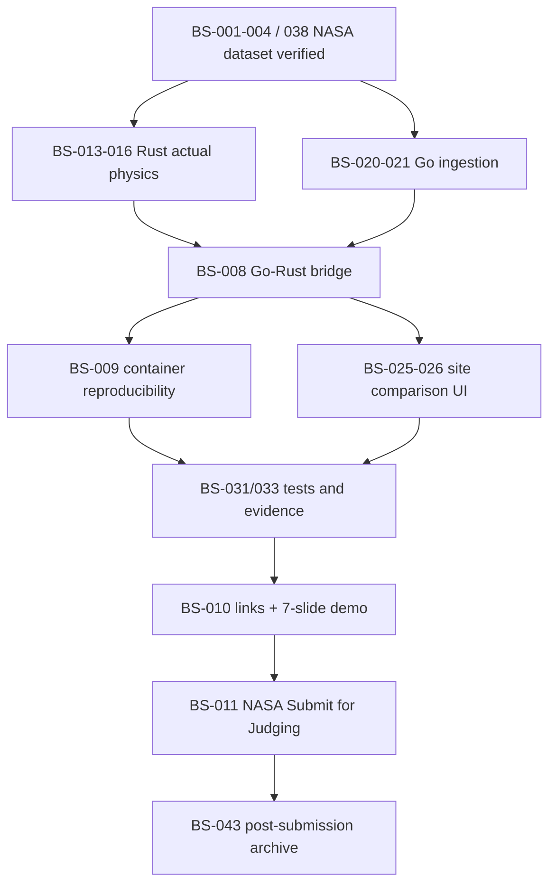

# BS-007 — MVP Freeze and Dependency Graph
Last recorded: 2026-11-14. This is a **proposed technical freeze** for team review; it does not certify all six participants approved it.

## P0 acceptance gates (not marketing claims)

1. Data owner [BS-002/003/038](../issues/2): exactly one NASA LOLA terrain product selected, source URL and SHA-256, units and frame documented; physical file or reproducible download available.
2. Rust science [BS-013–016](https://github.com/Braspace/Braspace/issues/13): numeric skyline from real DEM; Sun/Earth angles from real ephemerides; 2 independent reference checks; report worst residual.
3. API [BS-019–023](https://github.com/Braspace/Braspace/issues/19): typed request-response; NASA provenance correctly passed; no acceptance of synthetic labels as NASA values; bounded runtime.
4. Integration [BS-008/009](https://github.com/Braspace/Braspace/issues/8): actual Rust binary invoked by Go; self-hosted Compose builds from clean machine; CI + logs attached.
5. UX [BS-025–028](https://github.com/Braspace/Braspace/issues/25): three-site comparison, dates and local horizon, keyboard/screen-reader evaluation, truthful missing-data treatment.
6. QA [BS-031–034](https://github.com/Braspace/Braspace/issues/31): independent references, provenance, public anonymous access, external-use licensing and AI disclosures.
7. Publishing [BS-010/011](https://github.com/Braspace/Braspace/issues/10): public repo/app, <=7-slide deck, anonymous link checks, submission by authorized registered member, timestamp and confirmation.

## Explicit exclusions before validated evidence

No AI mission recommendation; no invented 60-day power, sunlight or DSN availability; no flight-grade risk score; no unverified 3D/LOLA terrain imagery; no NASA affiliation claims; no new external secrets.

## Definition of done

A task is done **only** with a reviewer-approved PR, CI green or documented environment-specific failure, empirical evidence of scientific inputs and outputs where applicable, and working artifact URL. A draft PR is not completed work. No automatic closure of BS-011 until the NASA portal confirms submission.
