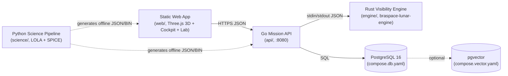

# BRASPACE — System Architecture

**Updated:** 2026-11-14 | **Status:** Active prototype (`UNVERIFIED_INPUTS` / `scientifically_validated: false` — not flight-certified).

## Overview

BRASPACE (MoonProof) is structured as four decoupled layers:

1. **Frontend Web 3D & Mission Control (`web/`)** — Static HTML/JS/CSS (Three.js 3D Moon, Polar Lab, Onboard Mission Computer Cockpit, Polar Elevation Map, Mission Studio) served via GitHub Pages or `web/dev-server.mjs` in local development.
2. **Mission API (`api/`, Go)** — HTTP server (`braspace.mission.v1`, `:8080`) handling validation, site catalog, comparison, sky/delay/onboard evaluation, printable reports, and NASA asset proxying.
3. **Deterministic Visibility Engine (`engine/`, Rust)** — `braspace-lunar-engine` CLI subprocess invoked by the Go API over stdin/stdout JSON (ADR-0001).
4. **Offline Science & Data Verification (`science/`, `scripts/`, `data/`)** — Python pipeline for NASA LOLA (`LDEM_80S_80M`) DEMs, NAIF SPICE kernels, PGDA/Horizons benchmarks, and manifest/checksum verification (`scripts/verify_lola.py`, `tests/test_data_contract.py`).

## Runtime Topology

### 1. Mission API (`api/`, Go)

- **Contract & Docs:** `api/openapi.json` and [`docs/MISSION_API.md`](MISSION_API.md).
- **Core Routes:**
  - Health & Capabilities: `GET /api/health`, `GET /readyz`, `GET /v1/capabilities`.
  - Visibility: `POST /v1/visibility` (strict JSON, `<128 KiB`, 2s deadline, `MOON_ME` frame).
  - Site Catalog & Analysis: `GET /api/sites`, `POST /api/compare`, `GET /api/sky`, `POST /api/delay`.
  - Onboard Mission Computer (`api/onboard/`): `POST /api/onboard/evaluate`, `POST /api/onboard/site-evaluate`, `POST /api/onboard/report`.
  - Visual Asset Proxy: `GET /api/moon/texture`, `GET /api/moon/model`.
- **Site Data (`api/sitedata/`):** 16 catalog sites, of which 7 have stored time series (`5` `PRELIMINARY` LOLA+SPICE, `2` `SYNTHETIC`).

### 2. Rust Visibility Engine (`engine/`, `braspace-lunar-engine`)

- Invoked as a per-request subprocess by Go with JSON on `stdin` and one JSON response on `stdout` (ADR-0001).
- Performs deterministic circular horizon interpolation and Sun/Earth clearance margin calculations.
- Returns typed geometry fields, `MOON_ME` frame metadata, a SHA-256 request-level evidence passport, and `science_status: "UNVERIFIED_INPUTS"`.

### 3. Frontend Web 3D & Mission Control (`web/`)

- **Main Shell (`web/index.html`, `web/moon3d.js`):** Interactive 3D Moon (Three.js) with optional on-demand NASA SVS 14959 GLB model, site markers, and 5-module navigation.
- **Additional Views:** Polar Lab (`web/lab.html`), Onboard Mission Computer Cockpit (`web/onboard/cockpit.html`), Polar Elevation Map Demo (`web/polar-map-demo.html`), and Mission Studio (`web/studio/`).
- **Configuration:** Uses `window.BRASPACE_API_BASE` from `web/config.js` (empty for same-origin, or public API origin on GitHub Pages).
- **Local Dev Proxy:** `node web/dev-server.mjs` binds `127.0.0.1:5173` and forwards `/api/*`, `/readyz`, and `/v1/capabilities` to `127.0.0.1:8080` with strict CSP and static allowlisting.

### 4. PostgreSQL & Optional pgvector (`compose.db.yaml`, `compose.vector.yaml`)

- **Base (`compose.yaml`):** Runs the Go API + compiled Rust engine.
- **PostgreSQL (`compose.db.yaml`):** Runs `postgres:16-alpine`, an `ingest` init container (`/app/bin/api ingest`), and wires `DATABASE_URL` to `api`.
- **pgvector (`compose.vector.yaml`):** Optional metadata/semantic search extension (see [`docs/ADR-0003-pgvector-scope.md`](ADR-0003-pgvector-scope.md) and [`docs/PGVECTOR_OPTIONAL.md`](PGVECTOR_OPTIONAL.md)); never certifies lunar physics.

### 5. Offline Science & Data Contracts (`science/`, `scripts/`, `tests/`)

- **`science/`:** Offline Python pipeline computing terrain horizons and Sun/Earth angles from NASA LOLA (`LDEM_80S_80M`) and NAIF SPICE kernels, plus PGDA/Horizons benchmarks (`web/data/validation/`).
- **`scripts/verify_lola.py`:** Verifies `LDEM_80S_80M.img` file size, SHA-256 checksum, and little-endian `LSB_INTEGER` decoding against `data/manifest.json`.
- **`tests/test_data_contract.py`:** Validates `data/manifest.json`, `data/SCENARIOS.json`, `data/LUNAR_GALLERY.json`, and `verify_lola.py` claim boundaries.

## Architectural Decisions

### ADR-0001: Rust JSON-line subprocess behind Go API
- **Decision:** Go handles HTTP, validation, timeouts, and Postgres access; Rust handles deterministic geometry via stdin/stdout JSON subprocesses. Non-zero exits map to `502`; invalid requests map to `400`/`415`/`422`.
- **Trade-off:** Clean process isolation and toolchain separation at the cost of per-request spawn overhead.

### ADR-0002: Source provenance, not artificial confidence
- **Principle:** Never treat caller-supplied dataset identifiers as proof of ingestion. Every metric must surface its `science_status` (`PRELIMINARY`, `SYNTHETIC`, `UNVERIFIED_INPUTS`, `NOT_COMPUTED`) and provenance without inflating confidence.
