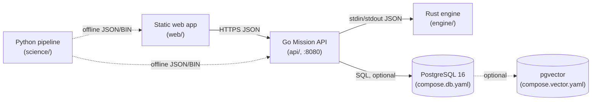

# BRASPACE - System architecture, ADR-0001 and interface boundaries

**Updated:** 2026-11-14. **Status:** active prototype. Science stays `UNVERIFIED_INPUTS` (`/readyz`) and `scientifically_validated: false` (`/v1/capabilities`); nothing here is flight-certified.

## Layers

BRASPACE (MoonProof) has four decoupled layers:

1. **Web (`web/`)**: static HTML/JS/CSS served by GitHub Pages or, locally, by `web/dev-server.mjs`. Main shell (`index.html`, `moon3d.js`: Explore, Compare, Recover, Science & Engineering, Evidence & Learn), MoonProof v3 screens (`moonproof/`), Mission Studio (`studio/`), Polar Landing Lab (`lab.html`, `lab/`), Onboard Cockpit (`onboard/cockpit.html`) and the polar map demo (`polar-map-demo.html`).
2. **Mission API (`api/`, Go)**: HTTP server on `:8080` (`braspace.mission.v1`). Contract in `api/openapi.json`, reference in [`API.md`](API.md) and [`MISSION_API.md`](MISSION_API.md).
3. **Visibility engine (`engine/`, Rust)**: `braspace-lunar-engine`, a CLI subprocess called by the Go API (ADR-0001).
4. **Offline science and data (`science/`, `scripts/`, `data/`)**: Python pipeline for NASA LOLA (`LDEM_80S_80M`), NAIF SPICE and the PGDA/Horizons benchmarks. Its output is committed as static JSON/BIN under `web/data/` and `api/sitedata/`. `api/cmd/verifylola` (Go) checks the raster size, SHA-256 and little-endian `LSB_INTEGER` decoding against `data/manifest.json`; its Go tests cover the manifest and claim boundaries.

## Runtime topology



```text
Client -- POST /v1/visibility ---> Go HTTP API (:8080)
                                  | input schema, <128KiB, 2s deadline
                                  v
                              Rust CLI subprocess
                              | interpolates supplied horizon
                              | compares supplied Sun/Earth angles
                                  v
                 JSON {sun_margin_deg, earth_margin_deg,
                       visible, science_status:UNVERIFIED_INPUTS}
```

- **Go** owns HTTP, validation, timeouts, safe failures, readiness, the site catalog and stored series (`api/sitedata/`: 16 catalog sites, 7 with a stored series, 5 `PRELIMINARY` LOLA+SPICE and 2 `SYNTHETIC`), the onboard mission computer (`api/onboard/`) and optional Postgres access (`api ingest`, `DATABASE_URL`).
- **Rust** owns deterministic geometry: circular linear interpolation of a **provided** terrain skyline and Sun/Earth clearance margins, with `MOON_ME` frame metadata. No DEM/SPICE IO. DEM ray tracing, frame transforms and Sun/Earth look angles in Rust would need a separate validation PR.
- **PostgreSQL** (`compose.db.yaml`: `postgres:16-alpine` plus an `ingest` init container running `/app/bin/api ingest`) and **pgvector** (`compose.vector.yaml`, optional metadata search, see [`ADR-0003-pgvector-scope.md`](ADR-0003-pgvector-scope.md) and [`PGVECTOR_OPTIONAL.md`](PGVECTOR_OPTIONAL.md)) are not needed to run the base stack and never certify lunar physics.
- **Web** reads the API through `window.BRASPACE_API_BASE` (`moon3d.js`; empty for same-origin, or the public API origin on GitHub Pages, see [`web/README.md`](../web/README.md)). `node web/dev-server.mjs` binds `127.0.0.1:5173` (`BRASPACE_WEB_PORT`), serves a fixed static allowlist under a strict CSP and forwards `/api/*`, `/healthz`, `/readyz` and `/v1/capabilities` to `127.0.0.1:8080`.
- **UI** must surface both provenance and `science_status`; never hide the warning or turn it into a verdict.
- **CI** (`.github/workflows/ci.yml` runs `scripts/ci-local.sh`) checks the Dockerfile `test` target (Go vet and race, Rust, web lint and tests, science), a Compose smoke with Postgres and the real Go-to-Rust process. CI does not constitute physical scientific validation. Test commands and measured counts: [`TESTING.md`](TESTING.md).

### API routes (from `api/openapi.json`)

| Group | Routes |
|---|---|
| Health and capabilities | `GET /api/health`, `GET /healthz`, `GET /readyz`, `GET /v1/capabilities`, `GET /api/openapi.json` |
| Visibility | `POST /v1/visibility` |
| Sites and analysis | `GET /api/sites`, `GET /api/sites/{id}`, `GET /api/sites/{id}/sky`, `GET /api/sites/{id}/media`, `POST /api/compare`, `POST /api/scenarios/delay` |
| Onboard mission computer | `POST /api/onboard/evaluate`, `POST /api/onboard/site-evaluate`, `POST /api/onboard/report`, `POST /api/onboard/site-report` |
| Visual layers (NASA assets, e.g. LROC texture and SVS 14959 Moon GLB) | `GET /api/layers`, `GET /api/layers/{id}`, `GET /api/layers/{id}/asset` |
| Optional vector search | `GET /api/vector/status`, `POST /api/vector/search` |

## ADR-0001: Rust JSON-line subprocess behind Go API

**Context.** BRASPACE has Go backend ownership, Rust science ownership and a hard hackathon deadline. An FFI shared-library ABI would create additional cross-toolchain and memory-safety integration risks.

**Decision.** Go accepts a strict JSON POST on `/v1/visibility`, bounds request size and deadline, and launches a compiled Rust executable with JSON on stdin and one JSON response on stdout. Non-zero exit codes map to HTTP 502; invalid requests map to 400/415/422. All science fields are typed, include explicit `MOON_ME` frame metadata, and declare `UNVERIFIED_INPUTS` until a trusted source pipeline is integrated.

**Consequences.** Straightforward process isolation and offline Docker builds after dependency download; per-request spawn overhead; container size; no streaming workloads yet. A production implementation could use a persistent worker pool only after a benchmark and protocol design. Never treat a submitted dataset identifier as proof of dataset ingestion. Integration does not implement lunar physics.

## Contract (`POST /v1/visibility`)

Example: [synthetic request](../examples/visibility.synthetic.json). Angles are degrees (azimuth 0° north / clockwise convention is a caller contract to standardize during science review), elevations in [-90, 90]; horizon samples strictly increasing and periodic across 0/360°. `epoch_utc` is RFC3339 UTC. Frame currently must be `MOON_ME`. Two or more samples allow circular interpolation. A zero margin is treated as mathematically tangent/visible, **not** proof of robust visibility.

Response contains numerical local horizon and clearance margins and three booleans, plus an **implemented request-level evidence passport** (added by the Go API, `api/main.go`) with SHA-256 of the normalized JSON request. This hash does **not** authenticate NASA dataset bytes or ephemeris kernel provenance. `GET /v1/capabilities` explicitly advertises unavailable physics. Full server-signed asset provenance remains a future ADR-0002 requirement. The classification is only as accurate as the source angles and skyline. Sun disc width, refraction, limb effects, antenna link budget, Earth occultation, DSN scheduling, lunar eclipses, terrain uncertainty and time-series windows are **not modeled**.

## ADR-0002: Source provenance, not artificial confidence

**Proposed.** New real-data API must accept **immutable** data asset identifiers, checksums/frames/epochs *from a server-side NASA data manifest*, not trust caller-supplied strings. Every computed metric should link to an auditable `EvidencePassport` containing exact source and version, spatial/temporal resolution, coordinate transform, algorithm version, reference test residual and limitations. Support `NOT_COMPUTED` / `ESTIMATED` / `VALIDATED`, backed by evidence and not client-chosen status. Today no product in the repo is `VALIDATED`; statuses in use are `PRELIMINARY`, `SYNTHETIC`, `SIMULATION`, `BENCHMARK` and `UNVERIFIED_INPUTS`.

## Change safety

Changes go through pull requests and review; production secrets and the NASA portal are not touched from the repo. Docker image tags should be digest-pinned before claiming strict reproducibility (`engine/Cargo.lock` is committed and CI uses `cargo test --locked`).
