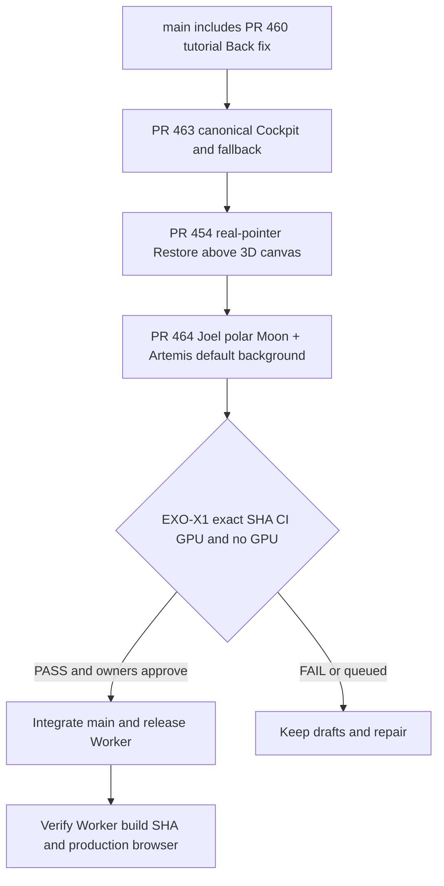

# BRASPACE MoonProof — Engineering Loop P0 checkpoint

**Snapshot:** 2026-11-15, ~21:20 America/Sao_Paulo. **This is an engineering handoff, not evidence of a production release.**

## Product decision (source of truth)

- Canonical product URL: `/moonproof/` → the single Preact/Three.js `cockpit.html`, retaining URL query/hash/history. The three pre-existing modes **Explore / Teach / Plan** remain alive at `/moonproof/tasks.html` and their deep links. No destructive removal of other contributors' work.
- **One** Joel Moon HD South Pole WebGL scene, **one** shared Artemis-style (illustrative) lander, **nine independently collapsible** cockpit panels. Moon-only mode clears UI; Restore returns it via a real pointer and keyboard.
- Heloísa design system: compact ~75% desktop-density while keeping 44px minimum touch targets, glass surfaces, accessible contrast, no horizontal overflow 320–1920 px.
- Go API + Rust engine + PostgreSQL stored hourly series; pgvector 384D is provenance/metadata retrieval **only**, never the visibility physics engine.
- Scientific outputs remain **UNVERIFIED_INPUTS**, series **PRELIMINARY** (14) or **SYNTHETIC** (2), not flight-certified.

## Dependency graph (ordered integration proposal)

PRs #454 and #464 both change `web/browser/cockpit-panels.e2e.mjs`. Keep **both** tests: 3D canvas/poster fallback and actual user click on Restore without JavaScript DOM injection. PRs #463 and #464 touch `web/tests/moon-backdrop.test.mjs`; preserve the canonical adapter (no Moon from `index.html`) and the non-lazy cockpit entry (one Moon). Rebase after each merge. Never merge or deploy several drafts blindly.

| Work item | Candidate SHA at snapshot | Owner/gate |
|---|---|---|
| PR #463 — canonical entry, fallback, tutorial and tasks | `fc55adbbc83f33fb3197ff04ef41141647d0e5aa` | MAC route/integration + Heloísa UX |
| PR #454 — pointer Restore atop immersive scene | `b1510a58d3b53b0185597b1353703ac93aeda886` | MAC panels, E2E |
| PR #464 — Joel polar 3D + Artemis behind panels | `75a135ffb58bf16572fef33f144ae237657c962f` | MoonProof PWA/Joel scene, MAC review |
| Issue #456 — 3D always visible / shared one renderer | Not closed | MoonProof PWA + QA |
| Issue #457 — canonical Cockpit product decision | Not closed | MAC routing + PM |

## Evidence verified in this session

- GitHub source readback: **15/15 explicit static invariants** across the three candidate branches passed. This is **not** the Node test suite, CI, GPU, E2E or production certification.
- `https://braspace-moonproof.almeida-me.workers.dev/config.js` HTTP 200 contained `BRASPACE_COMMIT=109a147e1ffef9235ebeadca75d541c383b7f737` at the final check, matching observed `main`, **not** the three draft patches.
- Public API `/api/health`, `/readyz`, `/v1/capabilities`, `/api/vector/status`, `/api/sites`, `/api/sites/malapert-massif`: 6/6 read-only HTTP 200. Backend status PostgreSQL OK, engine ready, 16/16 site series, vector index 384D ready with 4 audited and 10 legacy-unverified metadata records.
- Browser session without hardware WebGL rendered the live cockpit and nine-panel toolbar, but reported **3D Moon unavailable on this device**. This is not an Artemis GPU acceptance test.
- EXO-X1/Desktop Commander disconnected in this session; local downloads ZIP/Markdown inaccessible. CI/Chromium/pgvector GitHub Actions for PRs #454/#463/#464 were **queued**, not green.

## Release / QA gate (do not skip)

- [ ] Capture the **latest** `main` SHA and compare with each PR head; reconcile agent work by owner in `docs/harness/OWNERS.md`. Never overwrite teammate edits or force-push main.
- [ ] On EXO-X1: exact SHA, lint/typecheck/build-generated drift, pinned Node tests, Go and Rust unit/integration tests, PostgreSQL 16/16 series and pgvector schema/vector tests, security scan and `scripts/ci-local.sh --browser` (actual command support to confirm on host).
- [ ] Chromium with hardware GPU + separate no-WebGL fallback: Joel south-pole 3D, Artemis above candidate site, shared renderer, correct pins from API, no duplicated context, restore control pointer hit-test, keyboard/Escape/ARIA, 44px targets, no errors, reduced motion.
- [ ] Six responsive sizes: 320, 390, 768, 1024, 1440 and 1920 px; Heloísa density and visual review; no UI obstructing selected sites.
- [ ] API through same-origin Worker (not cross-origin raw 403), readyz and negative 4xx JSON, deterministic Go/Rust computations, 14 PRELIMINARY + 2 SYNTHETIC visibility and no fake output.
- [ ] Merge only after CI and owner reviews, create release tag/notes, record DB backup and immutable backend image/Worker version rollback, deploy exact main build and verify `config.js` SHA and public browser smoke.

## Engineer-loop discipline

For each cycle, add a compact entry recording UTC/BRT timestamp, target SHA, exact tests with stdout/CI artifacts, changed files, outcomes and next blocking issue. Distinguish `READBACK`, `STATIC`, `NODE`, `CHROMIUM`, `EXO` and `PRODUCTION`. Never translate queued checks into PASS or claim scientific validation. Preserve the owner split in `docs/harness/OWNERS.md`.
